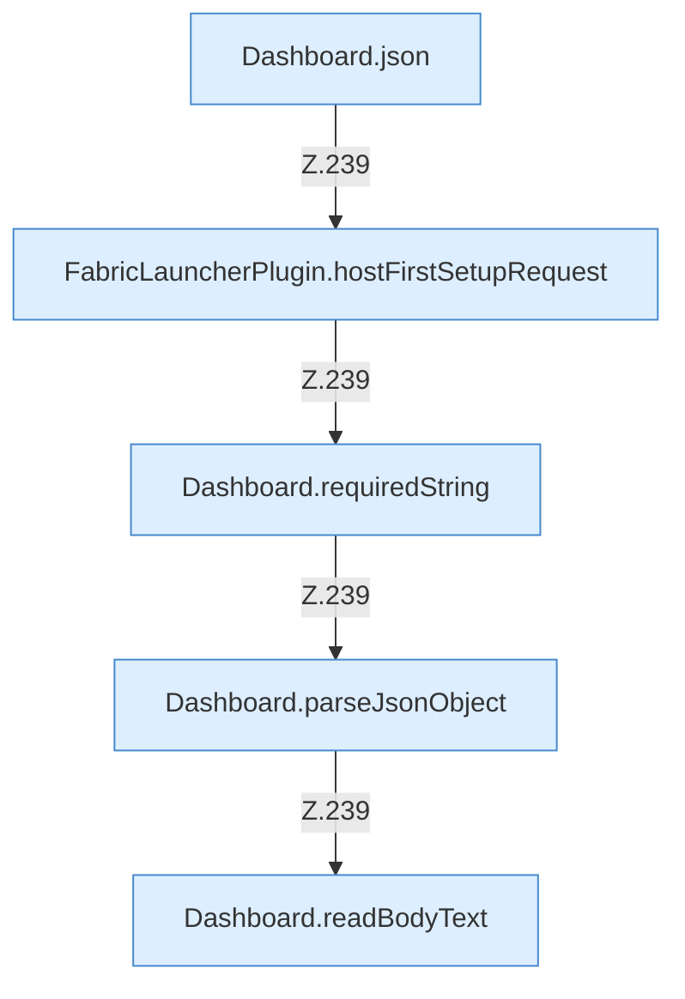

[[00 Start]] › [[Dashboard-HTTP]] › [[HTTP-Routing]] › [[Dashboard.handle]] › [[Dashboard.handle.Z103.Teil7.Z141.Case238]]

# Dashboard.handle.Z103.Teil7.Z141.Case238



```knoten
Dashboard.json
  Antwortet mit JSON `json`. Ruft `sendBytes`.
FabricLauncherPlugin.hostFirstSetupRequest
  Betrifft den Host `hostFirstSetupRequest`. Ruft `requestManual`, `hostFirstSetupMarker`.
Dashboard.requiredString
  Liest verpflichtend `requiredString`.
Dashboard.parseJsonObject
  Wertet aus `parseJsonObject`.
Dashboard.readBodyText
  Liest `readBodyText`.
```

- Fortsetzung von `Dashboard.handle.Z103.Teil7.Z141`, Quellreihenfolge.
