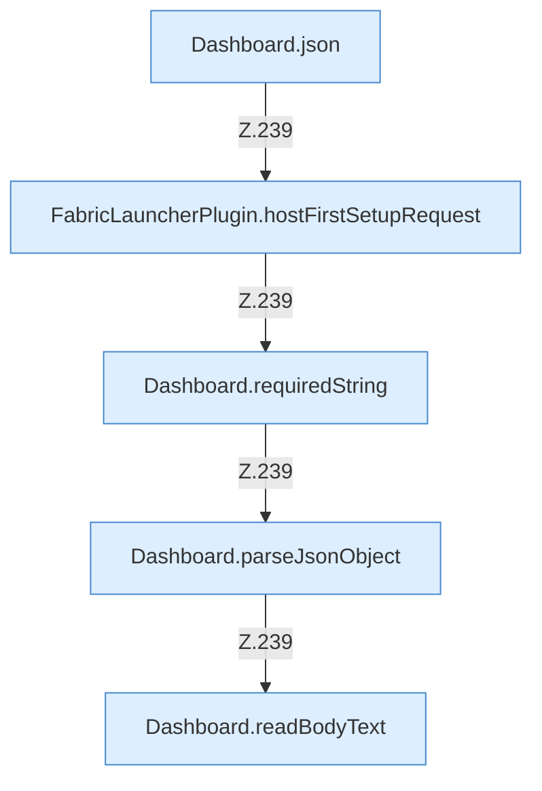

[[00 Start]] › [[Dashboard-HTTP]] › [[HTTP-Routing]] › [[Dashboard.handle]] › [[Dashboard.handle.Z103.Teil7.Z141.Case238]]

# Dashboard.handle.Z103.Teil7.Z141.Case238



```knoten
Dashboard.json
  Die [[Glossar#Web-Schnittstelle|Web-Schnittstelle]] macht hier einen einzelnen Schritt. Eine Ebene tiefer steht er genauer. Antwortet mit JSON `json`. Ruft `sendBytes`.
FabricLauncherPlugin.hostFirstSetupRequest
  Merkt den Wunsch, die [[Glossar#Ersteinrichtung|Ersteinrichtung]] von Hand anzustoßen. Betrifft den [[Glossar#Host|Host]] `hostFirstSetupRequest`. Ruft `requestManual`, `hostFirstSetupMarker`.
Dashboard.requiredString
  Liest einen Text, der in der Anfrage dabei sein muss. Liest verpflichtend `requiredString`.
Dashboard.parseJsonObject
  Die [[Glossar#Web-Schnittstelle|Web-Schnittstelle]] liest die Antwort den Inhalt. Wertet aus `parseJsonObject`.
Dashboard.readBodyText
  Die [[Glossar#Web-Schnittstelle|Web-Schnittstelle]] liest den Text den Text. Liest `readBodyText`.
```

> [!knoten]- Was die Blöcke tun
> - **Dashboard.json**: Die [[Glossar#Web-Schnittstelle|Web-Schnittstelle]] macht hier einen einzelnen Schritt. Eine Ebene tiefer steht er genauer. Antwortet mit JSON `json`. Ruft `sendBytes`.
> - **FabricLauncherPlugin.hostFirstSetupRequest**: Merkt den Wunsch, die [[Glossar#Ersteinrichtung|Ersteinrichtung]] von Hand anzustoßen. Betrifft den [[Glossar#Host|Host]] `hostFirstSetupRequest`. Ruft `requestManual`, `hostFirstSetupMarker`.
> - **Dashboard.requiredString**: Liest einen Text, der in der Anfrage dabei sein muss. Liest verpflichtend `requiredString`.
> - **Dashboard.parseJsonObject**: Die [[Glossar#Web-Schnittstelle|Web-Schnittstelle]] liest die Antwort den Inhalt. Wertet aus `parseJsonObject`.
> - **Dashboard.readBodyText**: Die [[Glossar#Web-Schnittstelle|Web-Schnittstelle]] liest den Text den Text. Liest `readBodyText`.

- Das Innere eines Wegs, ab [[Glossar#Zeile|Zeile]] 238.
- Fortsetzung von `Dashboard.handle.Z103.Teil7.Z141`.
