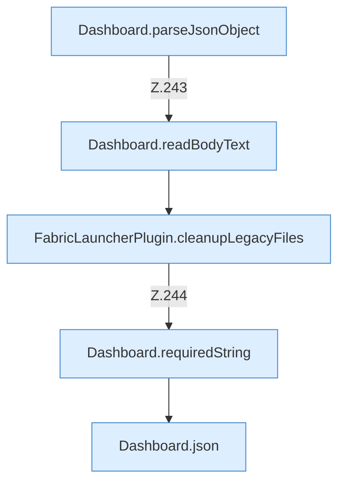

[[00 Start]] › [[Dashboard-HTTP]] › [[HTTP-Routing]] › [[Dashboard.handle]] › [[Dashboard.handle.Z103.Teil7.Z141.Case242]]

# Dashboard.handle.Z103.Teil7.Z141.Case242



```knoten
Dashboard.parseJsonObject
  Die [[Glossar#Web-Schnittstelle|Web-Schnittstelle]] liest die Antwort den Inhalt. Wertet aus `parseJsonObject`.
Dashboard.readBodyText
  Die [[Glossar#Web-Schnittstelle|Web-Schnittstelle]] liest den Text den Text. Liest `readBodyText`.
FabricLauncherPlugin.cleanupLegacyFiles
  Das [[Glossar#Plugin|Plugin]] räumt auf den alten Weg die Dateien. Räumt auf `cleanupLegacyFiles`. Ruft `legacyJarNames`, `legacyDataToPreserve`, `cleanupLegacyDirectory`.
Dashboard.requiredString
  Liest einen Text, der in der Anfrage dabei sein muss. Liest verpflichtend `requiredString`.
Dashboard.json
  Die [[Glossar#Web-Schnittstelle|Web-Schnittstelle]] macht hier einen einzelnen Schritt. Eine Ebene tiefer steht er genauer. Antwortet mit JSON `json`. Ruft `sendBytes`.
```

> [!knoten]- Was die Blöcke tun
> - **Dashboard.parseJsonObject**: Die [[Glossar#Web-Schnittstelle|Web-Schnittstelle]] liest die Antwort den Inhalt. Wertet aus `parseJsonObject`.
> - **Dashboard.readBodyText**: Die [[Glossar#Web-Schnittstelle|Web-Schnittstelle]] liest den Text den Text. Liest `readBodyText`.
> - **FabricLauncherPlugin.cleanupLegacyFiles**: Das [[Glossar#Plugin|Plugin]] räumt auf den alten Weg die Dateien. Räumt auf `cleanupLegacyFiles`. Ruft `legacyJarNames`, `legacyDataToPreserve`, `cleanupLegacyDirectory`.
> - **Dashboard.requiredString**: Liest einen Text, der in der Anfrage dabei sein muss. Liest verpflichtend `requiredString`.
> - **Dashboard.json**: Die [[Glossar#Web-Schnittstelle|Web-Schnittstelle]] macht hier einen einzelnen Schritt. Eine Ebene tiefer steht er genauer. Antwortet mit JSON `json`. Ruft `sendBytes`.

- Das Innere eines Wegs, ab [[Glossar#Zeile|Zeile]] 242.
- Fortsetzung von `Dashboard.handle.Z103.Teil7.Z141`.
