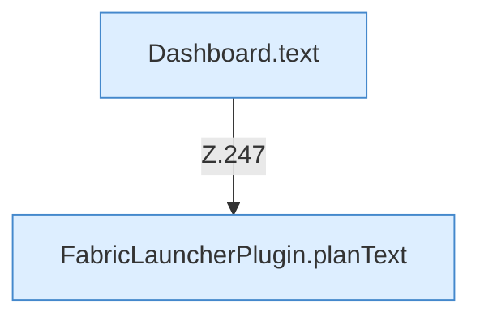

[[00 Start]] › [[Dashboard-HTTP]] › [[HTTP-Routing]] › [[Dashboard.handle]] › [[Dashboard.handle.Z103.Teil7.Z141.Case247]]

# Dashboard.handle.Z103.Teil7.Z141.Case247



```knoten
Dashboard.text
  Die [[Glossar#Web-Schnittstelle|Web-Schnittstelle]] macht hier einen einzelnen Schritt. Eine Ebene tiefer steht er genauer. Antwortet mit Text `text`. Ruft `sendBytes`.
FabricLauncherPlugin.planText
  Schreibt den [[Glossar#Startplan|Startplan]] als lesbaren Text. Zeigt den Startplan `planText`. Ruft `text`, `javaBin`, `profile`.
```

> [!knoten]- Was die Blöcke tun
> - **Dashboard.text**: Die [[Glossar#Web-Schnittstelle|Web-Schnittstelle]] macht hier einen einzelnen Schritt. Eine Ebene tiefer steht er genauer. Antwortet mit Text `text`. Ruft `sendBytes`.
> - **FabricLauncherPlugin.planText**: Schreibt den [[Glossar#Startplan|Startplan]] als lesbaren Text. Zeigt den Startplan `planText`. Ruft `text`, `javaBin`, `profile`.

- Das Innere eines Wegs, ab [[Glossar#Zeile|Zeile]] 247.
- Fortsetzung von `Dashboard.handle.Z103.Teil7.Z141`.
