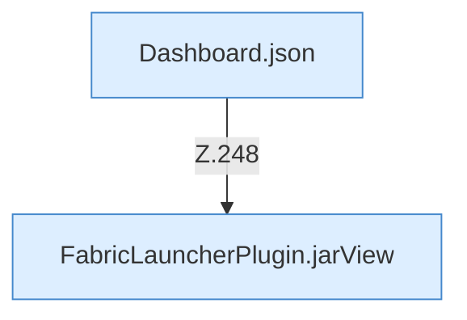

[[00 Start]] › [[Dashboard-HTTP]] › [[HTTP-Routing]] › [[Dashboard.handle]] › [[Dashboard.handle.Z103.Teil7.Z141.Case248]]

# Dashboard.handle.Z103.Teil7.Z141.Case248



```knoten
Dashboard.json
  Die [[Glossar#Web-Schnittstelle|Web-Schnittstelle]] macht hier einen einzelnen Schritt. Eine Ebene tiefer steht er genauer. Antwortet mit JSON `json`. Ruft `sendBytes`.
FabricLauncherPlugin.jarView
  Zeigt, welche [[Glossar#Programmdatei|Programmdatei]] der [[Glossar#Spielserver|Spielserver]] benutzt. Betrifft das Jar `jarView`. Ruft `view`, `inspect`, `profile`.
```

> [!knoten]- Was die Blöcke tun
> - **Dashboard.json**: Die [[Glossar#Web-Schnittstelle|Web-Schnittstelle]] macht hier einen einzelnen Schritt. Eine Ebene tiefer steht er genauer. Antwortet mit JSON `json`. Ruft `sendBytes`.
> - **FabricLauncherPlugin.jarView**: Zeigt, welche [[Glossar#Programmdatei|Programmdatei]] der [[Glossar#Spielserver|Spielserver]] benutzt. Betrifft das Jar `jarView`. Ruft `view`, `inspect`, `profile`.

- Das Innere eines Wegs, ab [[Glossar#Zeile|Zeile]] 248.
- Fortsetzung von `Dashboard.handle.Z103.Teil7.Z141`.
