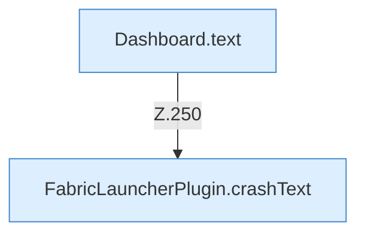

[[00 Start]] › [[Dashboard-HTTP]] › [[HTTP-Routing]] › [[Dashboard.handle]] › [[Dashboard.handle.Z103.Teil7.Z141.Case250]]

# Dashboard.handle.Z103.Teil7.Z141.Case250



```knoten
Dashboard.text
  Die [[Glossar#Web-Schnittstelle|Web-Schnittstelle]] macht hier einen einzelnen Schritt. Eine Ebene tiefer steht er genauer. Antwortet mit Text `text`. Ruft `sendBytes`.
FabricLauncherPlugin.crashText
  Zeigt den Text eines [[Glossar#Absturzbericht|Absturzberichts]]. Betrifft Crash-Reports `crashText`. Ruft `read`, `profile`, `directory`.
```

> [!knoten]- Was die Blöcke tun
> - **Dashboard.text**: Die [[Glossar#Web-Schnittstelle|Web-Schnittstelle]] macht hier einen einzelnen Schritt. Eine Ebene tiefer steht er genauer. Antwortet mit Text `text`. Ruft `sendBytes`.
> - **FabricLauncherPlugin.crashText**: Zeigt den Text eines [[Glossar#Absturzbericht|Absturzberichts]]. Betrifft Crash-Reports `crashText`. Ruft `read`, `profile`, `directory`.

- Das Innere eines Wegs, ab [[Glossar#Zeile|Zeile]] 250.
- Fortsetzung von `Dashboard.handle.Z103.Teil7.Z141`.
