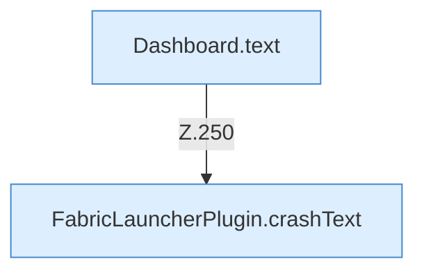

[[00 Start]] › [[Dashboard-HTTP]] › [[HTTP-Routing]] › [[Dashboard.handle]] › [[Dashboard.handle.Z103.Teil7.Z141.Case250]]

# Dashboard.handle.Z103.Teil7.Z141.Case250



```knoten
Dashboard.text
  Antwortet mit Text `text`. Ruft `sendBytes`.
FabricLauncherPlugin.crashText
  Betrifft Crash-Reports `crashText`. Ruft `read`, `profile`, `directory`.
```

- Fortsetzung von `Dashboard.handle.Z103.Teil7.Z141`, Quellreihenfolge.
