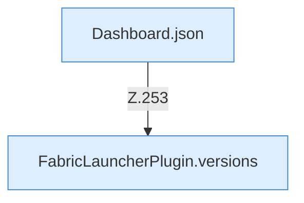

[[00 Start]] › [[Dashboard-HTTP]] › [[HTTP-Routing]] › [[Dashboard.handle]] › [[Dashboard.handle.Z103.Teil7.Z141.Case251]]

# Dashboard.handle.Z103.Teil7.Z141.Case251



```knoten
Dashboard.json
  Die [[Glossar#Web-Schnittstelle|Web-Schnittstelle]] macht hier einen einzelnen Schritt. Eine Ebene tiefer steht er genauer. Antwortet mit JSON `json`. Ruft `sendBytes`.
FabricLauncherPlugin.versions
  Liefert die bekannten [[Glossar#Version|Versionen]]. `versions` in `FabricLauncherPlugin.java`. Ruft `fetch`.
```

> [!knoten]- Was die Blöcke tun
> - **Dashboard.json**: Die [[Glossar#Web-Schnittstelle|Web-Schnittstelle]] macht hier einen einzelnen Schritt. Eine Ebene tiefer steht er genauer. Antwortet mit JSON `json`. Ruft `sendBytes`.
> - **FabricLauncherPlugin.versions**: Liefert die bekannten [[Glossar#Version|Versionen]]. `versions` in `FabricLauncherPlugin.java`. Ruft `fetch`.

- Das Innere eines Wegs, ab [[Glossar#Zeile|Zeile]] 251.
- Fortsetzung von `Dashboard.handle.Z103.Teil7.Z141`.
