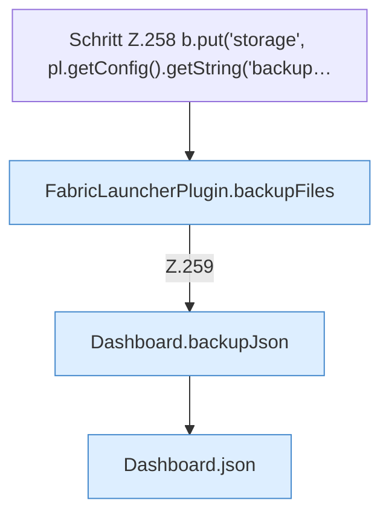

[[00 Start]] › [[Dashboard-HTTP]] › [[HTTP-Routing]] › [[Dashboard.handle]] › [[Dashboard.handle.Z103.Teil7.Z141.Case255]]

# Dashboard.handle.Z103.Teil7.Z141.Case255



```knoten
Schritt Z.258 b.put('storage', pl.getConfig().getString('backup…
  Zeile 258: liest die Config. `b.put('storage', pl.getConfig().getString('backup…`
FabricLauncherPlugin.backupFiles
  Sichert `backupFiles`. Ruft `remoteBackupSelected`, `backupCredentials`, `list`.
Dashboard.backupJson
  Sichert `backupJson`.
Dashboard.json
  Antwortet mit JSON `json`. Ruft `sendBytes`.
```

- Fortsetzung von `Dashboard.handle.Z103.Teil7.Z141`, Quellreihenfolge.
