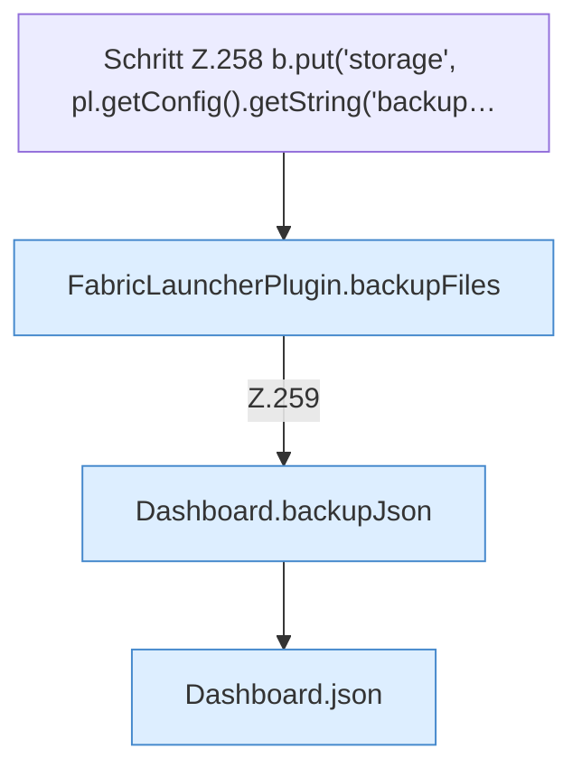

[[00 Start]] › [[Dashboard-HTTP]] › [[HTTP-Routing]] › [[Dashboard.handle]] › [[Dashboard.handle.Z103.Teil7.Z141.Case255]]

# Dashboard.handle.Z103.Teil7.Z141.Case255



```knoten
Schritt Z.258 b.put('storage', pl.getConfig().getString('backup…
  Zeile 258: liest die Config. `b.put('storage', pl.getConfig().getString('backup…`
FabricLauncherPlugin.backupFiles
  Das [[Glossar#Plugin|Plugin]] sichert die Dateien. Sichert `backupFiles`. Ruft `remoteBackupSelected`, `backupCredentials`, `list`.
Dashboard.backupJson
  Die [[Glossar#Web-Schnittstelle|Web-Schnittstelle]] sichert die Antwort. Sichert `backupJson`.
Dashboard.json
  Die [[Glossar#Web-Schnittstelle|Web-Schnittstelle]] macht hier einen einzelnen Schritt. Eine Ebene tiefer steht er genauer. Antwortet mit JSON `json`. Ruft `sendBytes`.
```

> [!knoten]- Was die Blöcke tun
> - **Schritt Z.258 b.put('storage', pl.getConfig().getString('backup…**: Zeile 258: liest die Config. `b.put('storage', pl.getConfig().getString('backup…`
> - **FabricLauncherPlugin.backupFiles**: Das [[Glossar#Plugin|Plugin]] sichert die Dateien. Sichert `backupFiles`. Ruft `remoteBackupSelected`, `backupCredentials`, `list`.
> - **Dashboard.backupJson**: Die [[Glossar#Web-Schnittstelle|Web-Schnittstelle]] sichert die Antwort. Sichert `backupJson`.
> - **Dashboard.json**: Die [[Glossar#Web-Schnittstelle|Web-Schnittstelle]] macht hier einen einzelnen Schritt. Eine Ebene tiefer steht er genauer. Antwortet mit JSON `json`. Ruft `sendBytes`.

- Das Innere eines Wegs, ab [[Glossar#Zeile|Zeile]] 255.
- Fortsetzung von `Dashboard.handle.Z103.Teil7.Z141`.
