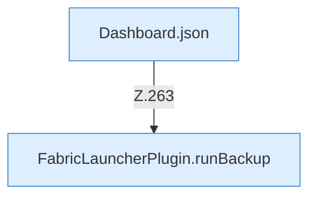

[[00 Start]] › [[Dashboard-HTTP]] › [[HTTP-Routing]] › [[Dashboard.handle]] › [[Dashboard.handle.Z103.Teil7.Z141.Case263]]

# Dashboard.handle.Z103.Teil7.Z141.Case263



```knoten
Dashboard.json
  Die [[Glossar#Web-Schnittstelle|Web-Schnittstelle]] macht hier einen einzelnen Schritt. Eine Ebene tiefer steht er genauer. Antwortet mit JSON `json`. Ruft `sendBytes`.
FabricLauncherPlugin.runBackup
  Das [[Glossar#Plugin|Plugin]] führt aus die [[Glossar#Sicherungskopie|Sicherungskopie]]. Führt aus `runBackup`. Ruft `slot`, `running`, `send`.
```

> [!knoten]- Was die Blöcke tun
> - **Dashboard.json**: Die [[Glossar#Web-Schnittstelle|Web-Schnittstelle]] macht hier einen einzelnen Schritt. Eine Ebene tiefer steht er genauer. Antwortet mit JSON `json`. Ruft `sendBytes`.
> - **FabricLauncherPlugin.runBackup**: Das [[Glossar#Plugin|Plugin]] führt aus die [[Glossar#Sicherungskopie|Sicherungskopie]]. Führt aus `runBackup`. Ruft `slot`, `running`, `send`.

- Das Innere eines Wegs, ab [[Glossar#Zeile|Zeile]] 263.
- Fortsetzung von `Dashboard.handle.Z103.Teil7.Z141`.
