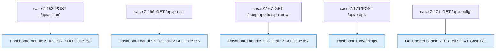

[[00 Start]] › [[Dashboard-HTTP]] › [[HTTP-Routing]] › [[Dashboard.handle]] › [[Dashboard.handle.Z103.Teil7.Z141.Cases152]]

# Dashboard.handle.Z103.Teil7.Z141.Cases152



```knoten
case Z.152 'POST /api/action'
  Zeile 152: Zweig `'POST /api/action'`.
Dashboard.handle.Z103.Teil7.Z141.Case152
  Das Innere eines Wegs, ab [[Glossar#Zeile|Zeile]] 152. Rumpf dieses switch-Zweigs ab Zeile 152.
case Z.166 'GET /api/props'
  Zeile 166: Zweig `'GET /api/props'`.
Dashboard.handle.Z103.Teil7.Z141.Case166
  Das Innere eines Wegs, ab [[Glossar#Zeile|Zeile]] 166. Rumpf dieses switch-Zweigs ab Zeile 166.
case Z.167 'GET /api/properties/preview'
  Zeile 167: Zweig `'GET /api/properties/preview'`.
Dashboard.handle.Z103.Teil7.Z141.Case167
  Das Innere eines Wegs, ab [[Glossar#Zeile|Zeile]] 167. Rumpf dieses switch-Zweigs ab Zeile 167.
case Z.170 'POST /api/props'
  Zeile 170: Zweig `'POST /api/props'`.
Dashboard.saveProps
  Die [[Glossar#Web-Schnittstelle|Web-Schnittstelle]] speichert die Eigenschaften. Speichert `saveProps`. Ruft `readBodyText`, `workDir`, `syncPropertiesEdit`.
case Z.171 'GET /api/config'
  Zeile 171: Zweig `'GET /api/config'`.
Dashboard.handle.Z103.Teil7.Z141.Case171
  Das Innere eines Wegs, ab [[Glossar#Zeile|Zeile]] 171. Rumpf dieses switch-Zweigs ab Zeile 171.
```

> [!knoten]- Was die Blöcke tun
> - **case Z.152 'POST /api/action'**: Zeile 152: Zweig `'POST /api/action'`.
> - **Dashboard.handle.Z103.Teil7.Z141.Case152**: Das Innere eines Wegs, ab [[Glossar#Zeile|Zeile]] 152. Rumpf dieses switch-Zweigs ab Zeile 152.
> - **case Z.166 'GET /api/props'**: Zeile 166: Zweig `'GET /api/props'`.
> - **Dashboard.handle.Z103.Teil7.Z141.Case166**: Das Innere eines Wegs, ab [[Glossar#Zeile|Zeile]] 166. Rumpf dieses switch-Zweigs ab Zeile 166.
> - **case Z.167 'GET /api/properties/preview'**: Zeile 167: Zweig `'GET /api/properties/preview'`.
> - **Dashboard.handle.Z103.Teil7.Z141.Case167**: Das Innere eines Wegs, ab [[Glossar#Zeile|Zeile]] 167. Rumpf dieses switch-Zweigs ab Zeile 167.
> - **case Z.170 'POST /api/props'**: Zeile 170: Zweig `'POST /api/props'`.
> - **Dashboard.saveProps**: Die [[Glossar#Web-Schnittstelle|Web-Schnittstelle]] speichert die Eigenschaften. Speichert `saveProps`. Ruft `readBodyText`, `workDir`, `syncPropertiesEdit`.
> - **case Z.171 'GET /api/config'**: Zeile 171: Zweig `'GET /api/config'`.
> - **Dashboard.handle.Z103.Teil7.Z141.Case171**: Das Innere eines Wegs, ab [[Glossar#Zeile|Zeile]] 171. Rumpf dieses switch-Zweigs ab Zeile 171.

- Weitere Wege der Entscheidung in [[Glossar#Zeile|Zeile]] 152.
- Fortsetzung von `Dashboard.handle.Z103.Teil7.Z141`.
