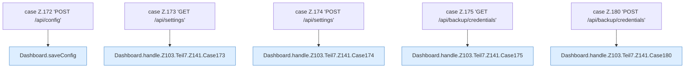

[[00 Start]] › [[Dashboard-HTTP]] › [[HTTP-Routing]] › [[Dashboard.handle]] › [[Dashboard.handle.Z103.Teil7.Z141.Cases172]]

# Dashboard.handle.Z103.Teil7.Z141.Cases172



```knoten
case Z.172 'POST /api/config'
  Zeile 172: Zweig `'POST /api/config'`.
Dashboard.saveConfig
  Speichert `saveConfig`. Ruft `readBodyText`, `json`, `configMutationLock`.
case Z.173 'GET /api/settings'
  Zeile 173: Zweig `'GET /api/settings'`.
Dashboard.handle.Z103.Teil7.Z141.Case173
  Rumpf dieses switch-Zweigs ab Zeile 173.
case Z.174 'POST /api/settings'
  Zeile 174: Zweig `'POST /api/settings'`.
Dashboard.handle.Z103.Teil7.Z141.Case174
  Rumpf dieses switch-Zweigs ab Zeile 174.
case Z.175 'GET /api/backup/credentials'
  Zeile 175: Zweig `'GET /api/backup/credentials'`.
Dashboard.handle.Z103.Teil7.Z141.Case175
  Rumpf dieses switch-Zweigs ab Zeile 175.
case Z.180 'POST /api/backup/credentials'
  Zeile 180: Zweig `'POST /api/backup/credentials'`.
Dashboard.handle.Z103.Teil7.Z141.Case180
  Rumpf dieses switch-Zweigs ab Zeile 180.
```

- Fortsetzung von `Dashboard.handle.Z103.Teil7.Z141`, Quellreihenfolge.
