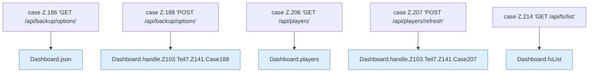

[[00 Start]] › [[Dashboard-HTTP]] › [[HTTP-Routing]] › [[Dashboard.handle]] › [[Dashboard.handle.Z103.Teil7.Z141.Cases186]]

# Dashboard.handle.Z103.Teil7.Z141.Cases186



```knoten
case Z.186 'GET /api/backup/options'
  Zeile 186: Zweig `'GET /api/backup/options'`.
Dashboard.json
  Die [[Glossar#Web-Schnittstelle|Web-Schnittstelle]] macht hier einen einzelnen Schritt. Eine Ebene tiefer steht er genauer. Antwortet mit JSON `json`. Ruft `sendBytes`.
case Z.188 'POST /api/backup/options'
  Zeile 188: Zweig `'POST /api/backup/options'`.
Dashboard.handle.Z103.Teil7.Z141.Case188
  Das Innere eines Wegs, ab [[Glossar#Zeile|Zeile]] 188. Rumpf dieses switch-Zweigs ab Zeile 188.
case Z.206 'GET /api/players'
  Zeile 206: Zweig `'GET /api/players'`.
Dashboard.players
  Liefert die [[Glossar#Spieler|Spieler]] an die [[Glossar#Bedienseite|Bedienseite]]. Liefert die Spieler `players`. Ruft `workDir`, `readPlayerNames`, `players`.
case Z.207 'POST /api/players/refresh'
  Zeile 207: Zweig `'POST /api/players/refresh'`.
Dashboard.handle.Z103.Teil7.Z141.Case207
  Das Innere eines Wegs, ab [[Glossar#Zeile|Zeile]] 207. Rumpf dieses switch-Zweigs ab Zeile 207.
case Z.214 'GET /api/fs/list'
  Zeile 214: Zweig `'GET /api/fs/list'`.
Dashboard.fsList
  Die [[Glossar#Web-Schnittstelle|Web-Schnittstelle]] zeigt eine Datei. `fsList` in `Dashboard.java`. Ruft `safe`, `json`, `rel`.
```

> [!knoten]- Was die Blöcke tun
> - **case Z.186 'GET /api/backup/options'**: Zeile 186: Zweig `'GET /api/backup/options'`.
> - **Dashboard.json**: Die [[Glossar#Web-Schnittstelle|Web-Schnittstelle]] macht hier einen einzelnen Schritt. Eine Ebene tiefer steht er genauer. Antwortet mit JSON `json`. Ruft `sendBytes`.
> - **case Z.188 'POST /api/backup/options'**: Zeile 188: Zweig `'POST /api/backup/options'`.
> - **Dashboard.handle.Z103.Teil7.Z141.Case188**: Das Innere eines Wegs, ab [[Glossar#Zeile|Zeile]] 188. Rumpf dieses switch-Zweigs ab Zeile 188.
> - **case Z.206 'GET /api/players'**: Zeile 206: Zweig `'GET /api/players'`.
> - **Dashboard.players**: Liefert die [[Glossar#Spieler|Spieler]] an die [[Glossar#Bedienseite|Bedienseite]]. Liefert die Spieler `players`. Ruft `workDir`, `readPlayerNames`, `players`.
> - **case Z.207 'POST /api/players/refresh'**: Zeile 207: Zweig `'POST /api/players/refresh'`.
> - **Dashboard.handle.Z103.Teil7.Z141.Case207**: Das Innere eines Wegs, ab [[Glossar#Zeile|Zeile]] 207. Rumpf dieses switch-Zweigs ab Zeile 207.
> - **case Z.214 'GET /api/fs/list'**: Zeile 214: Zweig `'GET /api/fs/list'`.
> - **Dashboard.fsList**: Die [[Glossar#Web-Schnittstelle|Web-Schnittstelle]] zeigt eine Datei. `fsList` in `Dashboard.java`. Ruft `safe`, `json`, `rel`.

- Weitere Wege der Entscheidung in [[Glossar#Zeile|Zeile]] 186.
- Fortsetzung von `Dashboard.handle.Z103.Teil7.Z141`.
