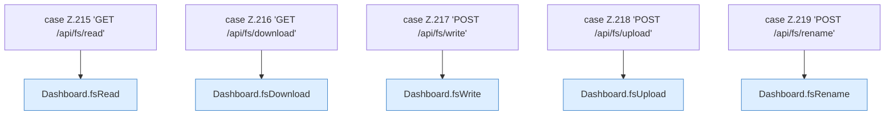

[[00 Start]] › [[Dashboard-HTTP]] › [[HTTP-Routing]] › [[Dashboard.handle]] › [[Dashboard.handle.Z103.Teil7.Z141.Cases215]]

# Dashboard.handle.Z103.Teil7.Z141.Cases215



```knoten
case Z.215 'GET /api/fs/read'
  Zeile 215: Zweig `'GET /api/fs/read'`.
Dashboard.fsRead
  `fsRead` in `Dashboard.java`. Ruft `safe`, `json`, `text`.
case Z.216 'GET /api/fs/download'
  Zeile 216: Zweig `'GET /api/fs/download'`.
Dashboard.fsDownload
  `fsDownload` in `Dashboard.java`. Ruft `safe`, `json`.
case Z.217 'POST /api/fs/write'
  Zeile 217: Zweig `'POST /api/fs/write'`.
Dashboard.fsWrite
  `fsWrite` in `Dashboard.java`. Ruft `safe`, `json`, `readBodyText`.
case Z.218 'POST /api/fs/upload'
  Zeile 218: Zweig `'POST /api/fs/upload'`.
Dashboard.fsUpload
  `fsUpload` in `Dashboard.java`. Ruft `safe`, `json`, `rel`.
case Z.219 'POST /api/fs/rename'
  Zeile 219: Zweig `'POST /api/fs/rename'`.
Dashboard.fsRename
  `fsRename` in `Dashboard.java`. Ruft `readBodyText`, `safe`, `root`.
```

- Fortsetzung von `Dashboard.handle.Z103.Teil7.Z141`, Quellreihenfolge.
