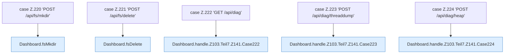

[[00 Start]] › [[Dashboard-HTTP]] › [[HTTP-Routing]] › [[Dashboard.handle]] › [[Dashboard.handle.Z103.Teil7.Z141.Cases220]]

# Dashboard.handle.Z103.Teil7.Z141.Cases220



```knoten
case Z.220 'POST /api/fs/mkdir'
  Zeile 220: Zweig `'POST /api/fs/mkdir'`.
Dashboard.fsMkdir
  `fsMkdir` in `Dashboard.java`. Ruft `safe`, `json`.
case Z.221 'POST /api/fs/delete'
  Zeile 221: Zweig `'POST /api/fs/delete'`.
Dashboard.fsDelete
  `fsDelete` in `Dashboard.java`. Ruft `readBodyText`, `safe`, `root`.
case Z.222 'GET /api/diag'
  Zeile 222: Zweig `'GET /api/diag'`.
Dashboard.handle.Z103.Teil7.Z141.Case222
  Rumpf dieses switch-Zweigs ab Zeile 222.
case Z.223 'POST /api/diag/threaddump'
  Zeile 223: Zweig `'POST /api/diag/threaddump'`.
Dashboard.handle.Z103.Teil7.Z141.Case223
  Rumpf dieses switch-Zweigs ab Zeile 223.
case Z.224 'POST /api/diag/heap'
  Zeile 224: Zweig `'POST /api/diag/heap'`.
Dashboard.handle.Z103.Teil7.Z141.Case224
  Rumpf dieses switch-Zweigs ab Zeile 224.
```

- Fortsetzung von `Dashboard.handle.Z103.Teil7.Z141`, Quellreihenfolge.
