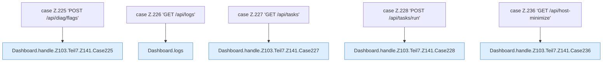

[[00 Start]] › [[Dashboard-HTTP]] › [[HTTP-Routing]] › [[Dashboard.handle]] › [[Dashboard.handle.Z103.Teil7.Z141.Cases225]]

# Dashboard.handle.Z103.Teil7.Z141.Cases225



```knoten
case Z.225 'POST /api/diag/flags'
  Zeile 225: Zweig `'POST /api/diag/flags'`.
Dashboard.handle.Z103.Teil7.Z141.Case225
  Rumpf dieses switch-Zweigs ab Zeile 225.
case Z.226 'GET /api/logs'
  Zeile 226: Zweig `'GET /api/logs'`.
Dashboard.logs
  `logs` in `Dashboard.java`. Ruft `parseInt`, `query`, `safe`.
case Z.227 'GET /api/tasks'
  Zeile 227: Zweig `'GET /api/tasks'`.
Dashboard.handle.Z103.Teil7.Z141.Case227
  Rumpf dieses switch-Zweigs ab Zeile 227.
case Z.228 'POST /api/tasks/run'
  Zeile 228: Zweig `'POST /api/tasks/run'`.
Dashboard.handle.Z103.Teil7.Z141.Case228
  Rumpf dieses switch-Zweigs ab Zeile 228.
case Z.236 'GET /api/host-minimize'
  Zeile 236: Zweig `'GET /api/host-minimize'`.
Dashboard.handle.Z103.Teil7.Z141.Case236
  Rumpf dieses switch-Zweigs ab Zeile 236.
```

- Fortsetzung von `Dashboard.handle.Z103.Teil7.Z141`, Quellreihenfolge.
