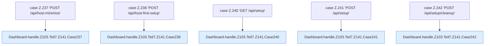

[[00 Start]] › [[Dashboard-HTTP]] › [[HTTP-Routing]] › [[Dashboard.handle]] › [[Dashboard.handle.Z103.Teil7.Z141.Cases237]]

# Dashboard.handle.Z103.Teil7.Z141.Cases237



```knoten
case Z.237 'POST /api/host-minimize'
  Zeile 237: Zweig `'POST /api/host-minimize'`.
Dashboard.handle.Z103.Teil7.Z141.Case237
  Das Innere eines Wegs, ab [[Glossar#Zeile|Zeile]] 237. Rumpf dieses switch-Zweigs ab Zeile 237.
case Z.238 'POST /api/host-first-setup'
  Zeile 238: Zweig `'POST /api/host-first-setup'`.
Dashboard.handle.Z103.Teil7.Z141.Case238
  Das Innere eines Wegs, ab [[Glossar#Zeile|Zeile]] 238. Rumpf dieses switch-Zweigs ab Zeile 238.
case Z.240 'GET /api/setup'
  Zeile 240: Zweig `'GET /api/setup'`.
Dashboard.handle.Z103.Teil7.Z141.Case240
  Das Innere eines Wegs, ab [[Glossar#Zeile|Zeile]] 240. Rumpf dieses switch-Zweigs ab Zeile 240.
case Z.241 'POST /api/setup'
  Zeile 241: Zweig `'POST /api/setup'`.
Dashboard.handle.Z103.Teil7.Z141.Case241
  Das Innere eines Wegs, ab [[Glossar#Zeile|Zeile]] 241. Rumpf dieses switch-Zweigs ab Zeile 241.
case Z.242 'POST /api/setup/cleanup'
  Zeile 242: Zweig `'POST /api/setup/cleanup'`.
Dashboard.handle.Z103.Teil7.Z141.Case242
  Das Innere eines Wegs, ab [[Glossar#Zeile|Zeile]] 242. Rumpf dieses switch-Zweigs ab Zeile 242.
```

> [!knoten]- Was die Blöcke tun
> - **case Z.237 'POST /api/host-minimize'**: Zeile 237: Zweig `'POST /api/host-minimize'`.
> - **Dashboard.handle.Z103.Teil7.Z141.Case237**: Das Innere eines Wegs, ab [[Glossar#Zeile|Zeile]] 237. Rumpf dieses switch-Zweigs ab Zeile 237.
> - **case Z.238 'POST /api/host-first-setup'**: Zeile 238: Zweig `'POST /api/host-first-setup'`.
> - **Dashboard.handle.Z103.Teil7.Z141.Case238**: Das Innere eines Wegs, ab [[Glossar#Zeile|Zeile]] 238. Rumpf dieses switch-Zweigs ab Zeile 238.
> - **case Z.240 'GET /api/setup'**: Zeile 240: Zweig `'GET /api/setup'`.
> - **Dashboard.handle.Z103.Teil7.Z141.Case240**: Das Innere eines Wegs, ab [[Glossar#Zeile|Zeile]] 240. Rumpf dieses switch-Zweigs ab Zeile 240.
> - **case Z.241 'POST /api/setup'**: Zeile 241: Zweig `'POST /api/setup'`.
> - **Dashboard.handle.Z103.Teil7.Z141.Case241**: Das Innere eines Wegs, ab [[Glossar#Zeile|Zeile]] 241. Rumpf dieses switch-Zweigs ab Zeile 241.
> - **case Z.242 'POST /api/setup/cleanup'**: Zeile 242: Zweig `'POST /api/setup/cleanup'`.
> - **Dashboard.handle.Z103.Teil7.Z141.Case242**: Das Innere eines Wegs, ab [[Glossar#Zeile|Zeile]] 242. Rumpf dieses switch-Zweigs ab Zeile 242.

- Weitere Wege der Entscheidung in [[Glossar#Zeile|Zeile]] 237.
- Fortsetzung von `Dashboard.handle.Z103.Teil7.Z141`.
