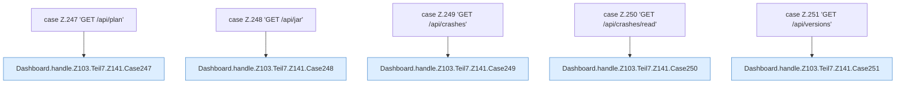

[[00 Start]] › [[Dashboard-HTTP]] › [[HTTP-Routing]] › [[Dashboard.handle]] › [[Dashboard.handle.Z103.Teil7.Z141.Cases247]]

# Dashboard.handle.Z103.Teil7.Z141.Cases247



```knoten
case Z.247 'GET /api/plan'
  Zeile 247: Zweig `'GET /api/plan'`.
Dashboard.handle.Z103.Teil7.Z141.Case247
  Das Innere eines Wegs, ab [[Glossar#Zeile|Zeile]] 247. Rumpf dieses switch-Zweigs ab Zeile 247.
case Z.248 'GET /api/jar'
  Zeile 248: Zweig `'GET /api/jar'`.
Dashboard.handle.Z103.Teil7.Z141.Case248
  Das Innere eines Wegs, ab [[Glossar#Zeile|Zeile]] 248. Rumpf dieses switch-Zweigs ab Zeile 248.
case Z.249 'GET /api/crashes'
  Zeile 249: Zweig `'GET /api/crashes'`.
Dashboard.handle.Z103.Teil7.Z141.Case249
  Das Innere eines Wegs, ab [[Glossar#Zeile|Zeile]] 249. Rumpf dieses switch-Zweigs ab Zeile 249.
case Z.250 'GET /api/crashes/read'
  Zeile 250: Zweig `'GET /api/crashes/read'`.
Dashboard.handle.Z103.Teil7.Z141.Case250
  Das Innere eines Wegs, ab [[Glossar#Zeile|Zeile]] 250. Rumpf dieses switch-Zweigs ab Zeile 250.
case Z.251 'GET /api/versions'
  Zeile 251: Zweig `'GET /api/versions'`.
Dashboard.handle.Z103.Teil7.Z141.Case251
  Das Innere eines Wegs, ab [[Glossar#Zeile|Zeile]] 251. Rumpf dieses switch-Zweigs ab Zeile 251.
```

> [!knoten]- Was die Blöcke tun
> - **case Z.247 'GET /api/plan'**: Zeile 247: Zweig `'GET /api/plan'`.
> - **Dashboard.handle.Z103.Teil7.Z141.Case247**: Das Innere eines Wegs, ab [[Glossar#Zeile|Zeile]] 247. Rumpf dieses switch-Zweigs ab Zeile 247.
> - **case Z.248 'GET /api/jar'**: Zeile 248: Zweig `'GET /api/jar'`.
> - **Dashboard.handle.Z103.Teil7.Z141.Case248**: Das Innere eines Wegs, ab [[Glossar#Zeile|Zeile]] 248. Rumpf dieses switch-Zweigs ab Zeile 248.
> - **case Z.249 'GET /api/crashes'**: Zeile 249: Zweig `'GET /api/crashes'`.
> - **Dashboard.handle.Z103.Teil7.Z141.Case249**: Das Innere eines Wegs, ab [[Glossar#Zeile|Zeile]] 249. Rumpf dieses switch-Zweigs ab Zeile 249.
> - **case Z.250 'GET /api/crashes/read'**: Zeile 250: Zweig `'GET /api/crashes/read'`.
> - **Dashboard.handle.Z103.Teil7.Z141.Case250**: Das Innere eines Wegs, ab [[Glossar#Zeile|Zeile]] 250. Rumpf dieses switch-Zweigs ab Zeile 250.
> - **case Z.251 'GET /api/versions'**: Zeile 251: Zweig `'GET /api/versions'`.
> - **Dashboard.handle.Z103.Teil7.Z141.Case251**: Das Innere eines Wegs, ab [[Glossar#Zeile|Zeile]] 251. Rumpf dieses switch-Zweigs ab Zeile 251.

- Weitere Wege der Entscheidung in [[Glossar#Zeile|Zeile]] 247.
- Fortsetzung von `Dashboard.handle.Z103.Teil7.Z141`.
