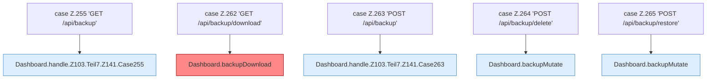

[[00 Start]] › [[Dashboard-HTTP]] › [[HTTP-Routing]] › [[Dashboard.handle]] › [[Dashboard.handle.Z103.Teil7.Z141.Cases255]]

# Dashboard.handle.Z103.Teil7.Z141.Cases255



```knoten
case Z.255 'GET /api/backup'
  Zeile 255: Zweig `'GET /api/backup'`.
Dashboard.handle.Z103.Teil7.Z141.Case255
  Das Innere eines Wegs, ab [[Glossar#Zeile|Zeile]] 255. Rumpf dieses switch-Zweigs ab Zeile 255.
case Z.262 'GET /api/backup/download'
  Zeile 262: Zweig `'GET /api/backup/download'`.
Dashboard.backupDownload
  Die [[Glossar#Web-Schnittstelle|Web-Schnittstelle]] sichert das Herunterladen. Sichert `backupDownload`. Ruft `backupFiles`, `downloadBackup`. [[Glossar#Befund|Befund]]: Logikrisiko, sicher. Dashboard.java nimmt die [[Glossar#Fokus|Fokus]]-ID, Query server wird ignoriert
case Z.263 'POST /api/backup'
  Zeile 263: Zweig `'POST /api/backup'`.
Dashboard.handle.Z103.Teil7.Z141.Case263
  Das Innere eines Wegs, ab [[Glossar#Zeile|Zeile]] 263. Rumpf dieses switch-Zweigs ab Zeile 263.
case Z.264 'POST /api/backup/delete'
  Zeile 264: Zweig `'POST /api/backup/delete'`.
Dashboard.backupMutate
  Ändert eine vorhandene [[Glossar#Sicherungskopie|Sicherungskopie]], zum Beispiel löschen oder zurückholen. Sichert `backupMutate`. Ruft `readBodyText`, `json`, `restoreBackup`.
case Z.265 'POST /api/backup/restore'
  Zeile 265: Zweig `'POST /api/backup/restore'`.
```

> [!knoten]- Was die Blöcke tun
> - **case Z.255 'GET /api/backup'**: Zeile 255: Zweig `'GET /api/backup'`.
> - **Dashboard.handle.Z103.Teil7.Z141.Case255**: Das Innere eines Wegs, ab [[Glossar#Zeile|Zeile]] 255. Rumpf dieses switch-Zweigs ab Zeile 255.
> - **case Z.262 'GET /api/backup/download'**: Zeile 262: Zweig `'GET /api/backup/download'`.
> - **Dashboard.backupDownload**: Die [[Glossar#Web-Schnittstelle|Web-Schnittstelle]] sichert das Herunterladen. Sichert `backupDownload`. Ruft `backupFiles`, `downloadBackup`. [[Glossar#Befund|Befund]]: Logikrisiko, sicher. Dashboard.java nimmt die [[Glossar#Fokus|Fokus]]-ID, Query server wird ignoriert
> - **case Z.263 'POST /api/backup'**: Zeile 263: Zweig `'POST /api/backup'`.
> - **Dashboard.handle.Z103.Teil7.Z141.Case263**: Das Innere eines Wegs, ab [[Glossar#Zeile|Zeile]] 263. Rumpf dieses switch-Zweigs ab Zeile 263.
> - **case Z.264 'POST /api/backup/delete'**: Zeile 264: Zweig `'POST /api/backup/delete'`.
> - **Dashboard.backupMutate**: Ändert eine vorhandene [[Glossar#Sicherungskopie|Sicherungskopie]], zum Beispiel löschen oder zurückholen. Sichert `backupMutate`. Ruft `readBodyText`, `json`, `restoreBackup`.
> - **case Z.265 'POST /api/backup/restore'**: Zeile 265: Zweig `'POST /api/backup/restore'`.

- Weitere Wege der Entscheidung in [[Glossar#Zeile|Zeile]] 255.
- Fortsetzung von `Dashboard.handle.Z103.Teil7.Z141`.
