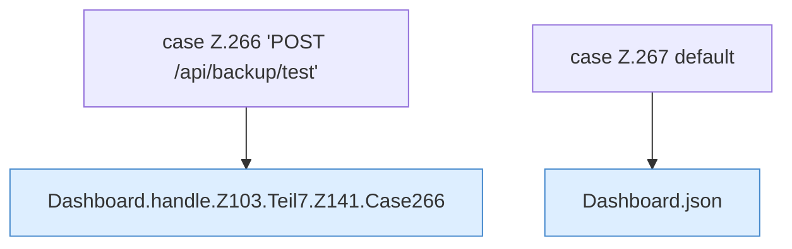

[[00 Start]] › [[Dashboard-HTTP]] › [[HTTP-Routing]] › [[Dashboard.handle]] › [[Dashboard.handle.Z103.Teil7.Z141.Cases266]]

# Dashboard.handle.Z103.Teil7.Z141.Cases266



```knoten
case Z.266 'POST /api/backup/test'
  Zeile 266: Zweig `'POST /api/backup/test'`.
Dashboard.handle.Z103.Teil7.Z141.Case266
  Rumpf dieses switch-Zweigs ab Zeile 266.
case Z.267 default
  Zeile 267: Zweig `default`.
Dashboard.json
  Antwortet mit JSON `json`. Ruft `sendBytes`.
```

- Fortsetzung von `Dashboard.handle.Z103.Teil7.Z141`, Quellreihenfolge.
