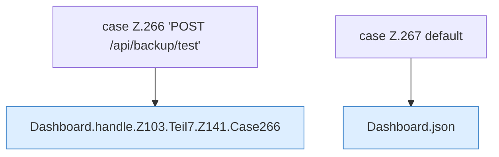

[[00 Start]] › [[Dashboard-HTTP]] › [[HTTP-Routing]] › [[Dashboard.handle]] › [[Dashboard.handle.Z103.Teil7.Z141.Cases266]]

# Dashboard.handle.Z103.Teil7.Z141.Cases266



```knoten
case Z.266 'POST /api/backup/test'
  Zeile 266: Zweig `'POST /api/backup/test'`.
Dashboard.handle.Z103.Teil7.Z141.Case266
  Das Innere eines Wegs, ab [[Glossar#Zeile|Zeile]] 266. Rumpf dieses switch-Zweigs ab Zeile 266.
case Z.267 default
  Zeile 267: Zweig `default`.
Dashboard.json
  Die [[Glossar#Web-Schnittstelle|Web-Schnittstelle]] macht hier einen einzelnen Schritt. Eine Ebene tiefer steht er genauer. Antwortet mit JSON `json`. Ruft `sendBytes`.
```

> [!knoten]- Was die Blöcke tun
> - **case Z.266 'POST /api/backup/test'**: Zeile 266: Zweig `'POST /api/backup/test'`.
> - **Dashboard.handle.Z103.Teil7.Z141.Case266**: Das Innere eines Wegs, ab [[Glossar#Zeile|Zeile]] 266. Rumpf dieses switch-Zweigs ab Zeile 266.
> - **case Z.267 default**: Zeile 267: Zweig `default`.
> - **Dashboard.json**: Die [[Glossar#Web-Schnittstelle|Web-Schnittstelle]] macht hier einen einzelnen Schritt. Eine Ebene tiefer steht er genauer. Antwortet mit JSON `json`. Ruft `sendBytes`.

- Weitere Wege der Entscheidung in [[Glossar#Zeile|Zeile]] 266.
- Fortsetzung von `Dashboard.handle.Z103.Teil7.Z141`.
