[[00 Start]] › [[Dashboard-HTTP]] › [[HTTP-Routing]] › [[Dashboard.handle]] › [[Dashboard.handle.Z103.Teil7.Z141]]

# Dashboard.handle.Z103.Teil7.Z141

```mermaid
flowchart TD
  n1["switch Z.141 (method + ' ' + path)"]
  n2["Dashboard.handle.Z103.Teil7.Z141.Cases142"]:::internal-link
  n3["Dashboard.handle.Z103.Teil7.Z141.Cases152"]:::internal-link
  n4["Dashboard.handle.Z103.Teil7.Z141.Cases172"]:::internal-link
  n5["Dashboard.handle.Z103.Teil7.Z141.Cases186"]:::internal-link
  n6["Dashboard.handle.Z103.Teil7.Z141.Cases215"]:::internal-link
  n7["Dashboard.handle.Z103.Teil7.Z141.Cases220"]:::internal-link
  n8["Dashboard.handle.Z103.Teil7.Z141.Cases225"]:::internal-link
  n9["Dashboard.handle.Z103.Teil7.Z141.Cases237"]:::internal-link
  n10["Dashboard.handle.Z103.Teil7.Z141.Cases247"]:::internal-link
  n11["Dashboard.handle.Z103.Teil7.Z141.Cases255"]:::internal-link
  n12["Dashboard.handle.Z103.Teil7.Z141.Cases266"]:::internal-link
  n1 -->|"Teil 1"| n2
  n1 -->|"Teil 2"| n3
  n1 -->|"Teil 3"| n4
  n1 -->|"Teil 4"| n5
  n1 -->|"Teil 5"| n6
  n1 -->|"Teil 6"| n7
  n1 -->|"Teil 7"| n8
  n1 -->|"Teil 8"| n9
  n1 -->|"Teil 9"| n10
  n1 -->|"Teil 10"| n11
  n1 -->|"Teil 11"| n12
  classDef internal-link fill:#ddeeff,stroke:#4488cc
  classDef befund fill:#f88
```

- Fortsetzung von `Dashboard.handle.Z103.Teil7`, Quellreihenfolge.
