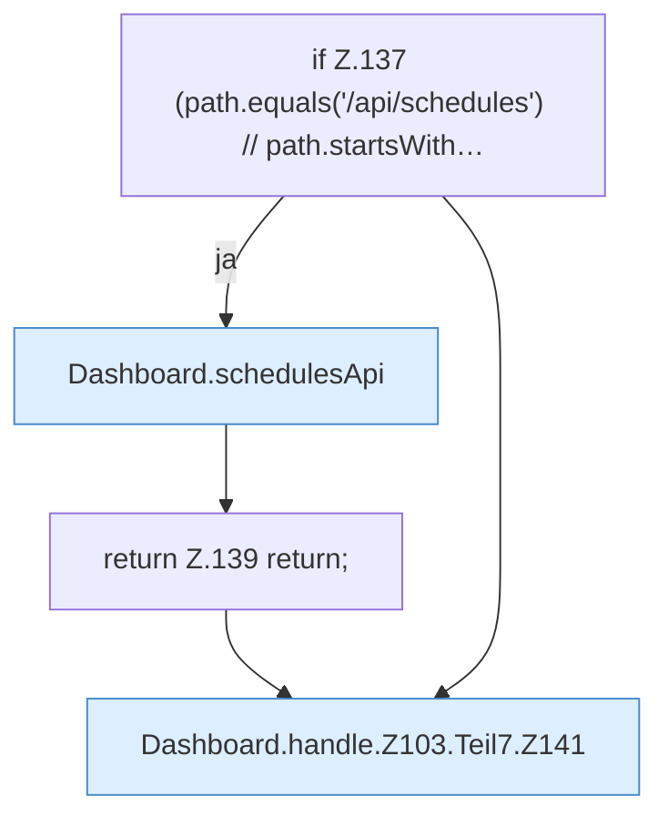

[[00 Start]] › [[Dashboard-HTTP]] › [[HTTP-Routing]] › [[Dashboard.handle]] › [[Dashboard.handle.Z103.Teil7]]

# Dashboard.handle.Z103.Teil7



```knoten
if Z.137 (path.equals('/api/schedules') // path.startsWith…
  Zeile 137: prüft `(path.equals('/api/schedules') // path.startsWith…`.
Dashboard.schedulesApi
  Nimmt Aufträge zu den Zeitplänen an. `schedulesApi` in `Dashboard.java`. Ruft `json`, `schedules`, `scheduleJson`.
return Z.139 return;
  Zeile 139: Rückgabe `return;`.
Dashboard.handle.Z103.Teil7.Z141
  Der Ablauf geht in [[Glossar#Zeile|Zeile]] 141 weiter. Eine Ebene tiefer steht er genauer. Fortsetzung des Ablaufs ab Zeile 141.
```

> [!knoten]- Was die Blöcke tun
> - **if Z.137 (path.equals('/api/schedules') // path.startsWith…**: Zeile 137: prüft `(path.equals('/api/schedules') // path.startsWith…`.
> - **Dashboard.schedulesApi**: Nimmt Aufträge zu den Zeitplänen an. `schedulesApi` in `Dashboard.java`. Ruft `json`, `schedules`, `scheduleJson`.
> - **return Z.139 return;**: Zeile 139: Rückgabe `return;`.
> - **Dashboard.handle.Z103.Teil7.Z141**: Der Ablauf geht in [[Glossar#Zeile|Zeile]] 141 weiter. Eine Ebene tiefer steht er genauer. Fortsetzung des Ablaufs ab Zeile 141.

- Ein weiterer Abschnitt derselben Übersicht.
- Fortsetzung von `Dashboard.handle.Z103`.
