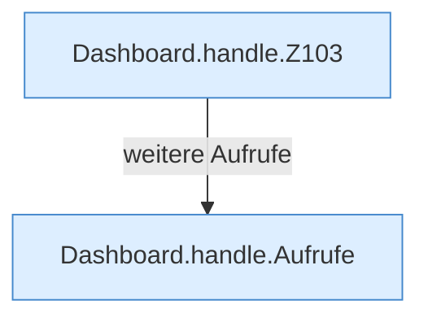

[[00 Start]] › [[Dashboard-HTTP]] › [[HTTP-Routing]] › [[Dashboard.handle]]

# Dashboard.handle

`Dashboard.handle(HttpExchange ex)` [src/main/java/de/aichele/childlauncher/Dashboard.java:102–281](https://github.com/Sciddie/minecraft-serverhoster-plugin/blob/95b02b953b0b4c23673e900e021a7c3c844aa37d/src/main/java/de/aichele/childlauncher/Dashboard.java#L102-L281)



```knoten
Dashboard.handle.Z103
  Der Ablauf geht in [[Glossar#Zeile|Zeile]] 103 weiter. Eine Ebene tiefer steht er genauer. Im [[Glossar#Quelltext|Quelltext]] heißt das `Z103`.
Dashboard.handle.Aufrufe
  Aufrufe, die das Diagramm nicht in den gezeichneten Ablauf gesetzt hat. Im [[Glossar#Quelltext|Quelltext]] heißt das `Aufrufe`.
```

> [!knoten]- Was die Blöcke tun
> - **Dashboard.handle.Z103**: Der Ablauf geht in [[Glossar#Zeile|Zeile]] 103 weiter. Eine Ebene tiefer steht er genauer. Im [[Glossar#Quelltext|Quelltext]] heißt das `Z103`.
> - **Dashboard.handle.Aufrufe**: Aufrufe, die das Diagramm nicht in den gezeichneten Ablauf gesetzt hat. Im [[Glossar#Quelltext|Quelltext]] heißt das `Aufrufe`.

- Nimmt eine Anfrage des Browsers an und verteilt sie an [[Glossar#Anmeldung|Anmeldung]], Zustand, Dateien oder die anderen Aufträge.
- ungeprüft: Ablaufparser oder nachgetragene Aufrufe, siehe [[bericht]].
