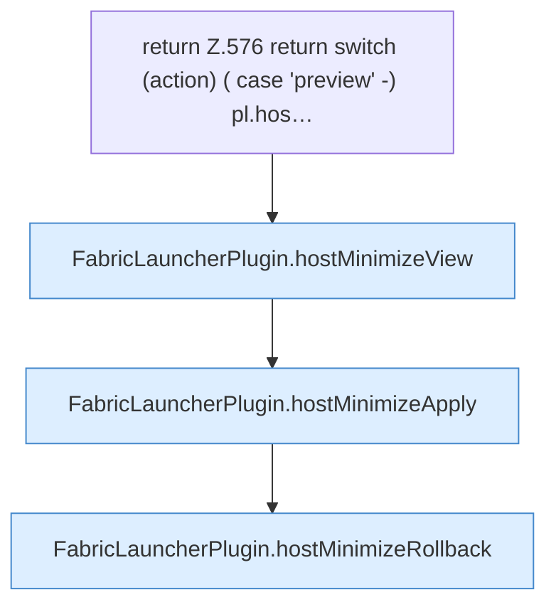

[[00 Start]] › [[Dashboard-HTTP]] › [[API-Setup]] › [[Dashboard.hostMinimize]] › [[Dashboard.hostMinimize.Z576]]

# Dashboard.hostMinimize.Z576



```knoten
return Z.576 return switch (action) ( case 'preview' -) pl.hos…
  Zeile 576: Rückgabe `return switch (action) ( case 'preview' -) pl.hos…`.
FabricLauncherPlugin.hostMinimizeView
  Betrifft den Host `hostMinimizeView`. Ruft `readHostMinimizeState`, `configuredHostWorld`, `preview`.
FabricLauncherPlugin.hostMinimizeApply
  Betrifft den Host `hostMinimizeApply`. Ruft `focusSlot`, `running`, `stopBlocking`.
FabricLauncherPlugin.hostMinimizeRollback
  Betrifft den Host `hostMinimizeRollback`. Ruft `readHostMinimizeState`, `restore`, `getWorldRoot`.
```

- Fortsetzung von `Dashboard.hostMinimize`, Quellreihenfolge.
