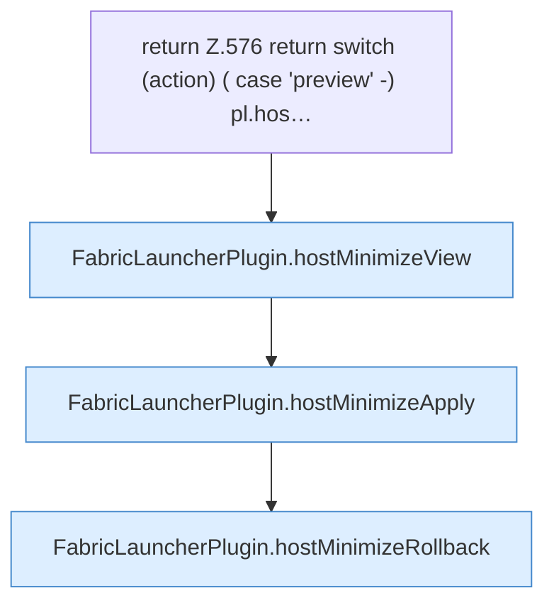

[[00 Start]] › [[Dashboard-HTTP]] › [[API-Setup]] › [[Dashboard.hostMinimize]] › [[Dashboard.hostMinimize.Z576]]

# Dashboard.hostMinimize.Z576



```knoten
return Z.576 return switch (action) ( case 'preview' -) pl.hos…
  Zeile 576: Rückgabe `return switch (action) ( case 'preview' -) pl.hos…`.
FabricLauncherPlugin.hostMinimizeView
  Das [[Glossar#Plugin|Plugin]] kümmert sich um das Verkleinern die Ansicht. Betrifft den [[Glossar#Host|Host]] `hostMinimizeView`. Ruft `readHostMinimizeState`, `configuredHostWorld`, `preview`.
FabricLauncherPlugin.hostMinimizeApply
  Das [[Glossar#Plugin|Plugin]] kümmert sich um das Verkleinern das Anwenden. Betrifft den [[Glossar#Host|Host]] `hostMinimizeApply`. Ruft `focusSlot`, `running`, `stopBlocking`.
FabricLauncherPlugin.hostMinimizeRollback
  Das [[Glossar#Plugin|Plugin]] macht hier einen einzelnen Schritt. Eine Ebene tiefer steht er genauer. Betrifft den [[Glossar#Host|Host]] `hostMinimizeRollback`. Ruft `readHostMinimizeState`, `restore`, `getWorldRoot`.
```

> [!knoten]- Was die Blöcke tun
> - **return Z.576 return switch (action) ( case 'preview' -) pl.hos…**: Zeile 576: Rückgabe `return switch (action) ( case 'preview' -) pl.hos…`.
> - **FabricLauncherPlugin.hostMinimizeView**: Das [[Glossar#Plugin|Plugin]] kümmert sich um das Verkleinern die Ansicht. Betrifft den [[Glossar#Host|Host]] `hostMinimizeView`. Ruft `readHostMinimizeState`, `configuredHostWorld`, `preview`.
> - **FabricLauncherPlugin.hostMinimizeApply**: Das [[Glossar#Plugin|Plugin]] kümmert sich um das Verkleinern das Anwenden. Betrifft den [[Glossar#Host|Host]] `hostMinimizeApply`. Ruft `focusSlot`, `running`, `stopBlocking`.
> - **FabricLauncherPlugin.hostMinimizeRollback**: Das [[Glossar#Plugin|Plugin]] macht hier einen einzelnen Schritt. Eine Ebene tiefer steht er genauer. Betrifft den [[Glossar#Host|Host]] `hostMinimizeRollback`. Ruft `readHostMinimizeState`, `restore`, `getWorldRoot`.

- Der Ablauf geht in [[Glossar#Zeile|Zeile]] 576 weiter. Eine Ebene tiefer steht er genauer.
- Fortsetzung von `Dashboard.hostMinimize`.
