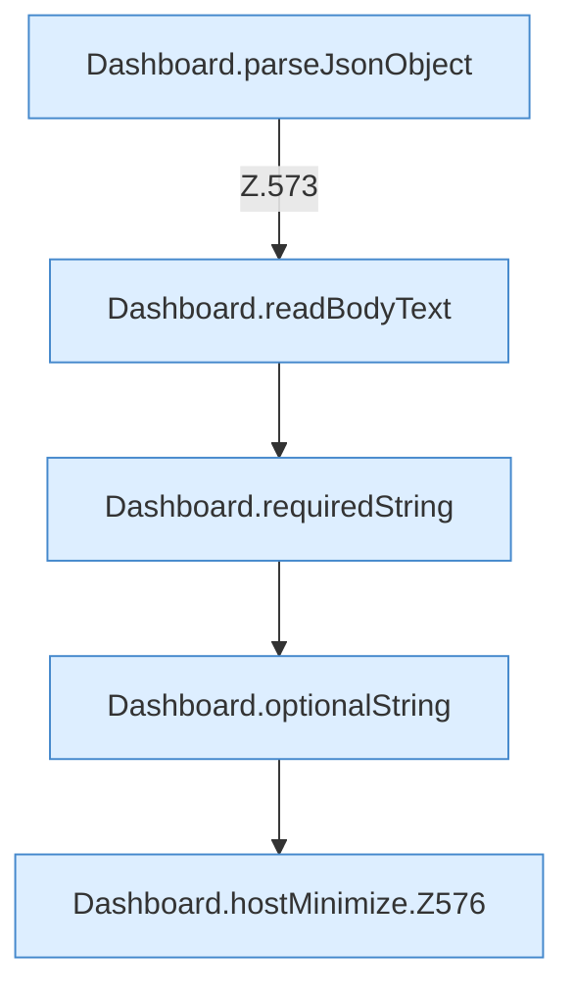

[[00 Start]] › [[Dashboard-HTTP]] › [[API-Setup]] › [[Dashboard.hostMinimize]]

# Dashboard.hostMinimize

`Dashboard.hostMinimize(HttpExchange ex)` [src/main/java/de/aichele/childlauncher/Dashboard.java:572–582](https://github.com/Sciddie/minecraft-serverhoster-plugin/blob/95b02b953b0b4c23673e900e021a7c3c844aa37d/src/main/java/de/aichele/childlauncher/Dashboard.java#L572-L582)



```knoten
Dashboard.parseJsonObject
  Die [[Glossar#Web-Schnittstelle|Web-Schnittstelle]] liest die Antwort den Inhalt. Im [[Glossar#Quelltext|Quelltext]] heißt das `parseJsonObject`.
Dashboard.readBodyText
  Die [[Glossar#Web-Schnittstelle|Web-Schnittstelle]] liest den Text den Text. Im [[Glossar#Quelltext|Quelltext]] heißt das `readBodyText`.
Dashboard.requiredString
  Liest einen Text, der in der Anfrage dabei sein muss. Im [[Glossar#Quelltext|Quelltext]] heißt das `requiredString`.
Dashboard.optionalString
  Liest einen Text, der in der Anfrage fehlen darf. Im [[Glossar#Quelltext|Quelltext]] heißt das `optionalString`.
Dashboard.hostMinimize.Z576
  Der Ablauf geht in [[Glossar#Zeile|Zeile]] 576 weiter. Eine Ebene tiefer steht er genauer. Im [[Glossar#Quelltext|Quelltext]] heißt das `Z576`.
```

> [!knoten]- Was die Blöcke tun
> - **Dashboard.parseJsonObject**: Die [[Glossar#Web-Schnittstelle|Web-Schnittstelle]] liest die Antwort den Inhalt. Im [[Glossar#Quelltext|Quelltext]] heißt das `parseJsonObject`.
> - **Dashboard.readBodyText**: Die [[Glossar#Web-Schnittstelle|Web-Schnittstelle]] liest den Text den Text. Im [[Glossar#Quelltext|Quelltext]] heißt das `readBodyText`.
> - **Dashboard.requiredString**: Liest einen Text, der in der Anfrage dabei sein muss. Im [[Glossar#Quelltext|Quelltext]] heißt das `requiredString`.
> - **Dashboard.optionalString**: Liest einen Text, der in der Anfrage fehlen darf. Im [[Glossar#Quelltext|Quelltext]] heißt das `optionalString`.
> - **Dashboard.hostMinimize.Z576**: Der Ablauf geht in [[Glossar#Zeile|Zeile]] 576 weiter. Eine Ebene tiefer steht er genauer. Im [[Glossar#Quelltext|Quelltext]] heißt das `Z576`.

- Nimmt von der [[Glossar#Bedienseite|Bedienseite]] den Auftrag an, den [[Glossar#Host|Host]] zu verkleinern oder das zurückzunehmen.
