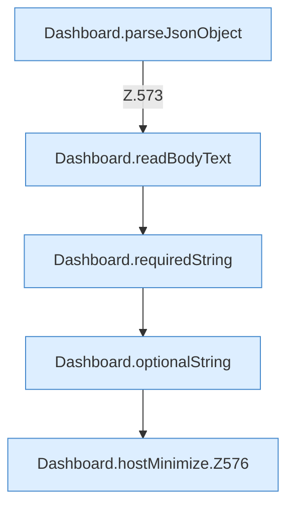

[[00 Start]] › [[Dashboard-HTTP]] › [[API-Setup]] › [[Dashboard.hostMinimize]]

# Dashboard.hostMinimize

`Dashboard.hostMinimize(HttpExchange ex)` [src/main/java/de/aichele/childlauncher/Dashboard.java:572–582](https://github.com/Sciddie/minecraft-serverhoster-plugin/blob/95b02b953b0b4c23673e900e021a7c3c844aa37d/src/main/java/de/aichele/childlauncher/Dashboard.java#L572-L582)



```knoten
Dashboard.parseJsonObject
  Wertet aus `parseJsonObject`.
Dashboard.readBodyText
  Liest `readBodyText`.
Dashboard.requiredString
  Liest verpflichtend `requiredString`.
Dashboard.optionalString
  Liest optional `optionalString`.
Dashboard.hostMinimize.Z576
  Fortsetzung des Ablaufs ab Zeile 576.
```

- `hostMinimize` in `src/main/java/de/aichele/childlauncher/Dashboard.java`
