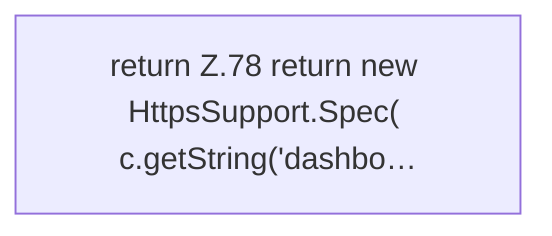

[[00 Start]] › [[Dashboard-HTTP]] › [[HTTP-Start]] › [[Dashboard.httpsSpec]]

# Dashboard.httpsSpec

`Dashboard.httpsSpec(FileConfiguration c)` [src/main/java/de/aichele/childlauncher/Dashboard.java:77–88](https://github.com/Sciddie/minecraft-serverhoster-plugin/blob/95b02b953b0b4c23673e900e021a7c3c844aa37d/src/main/java/de/aichele/childlauncher/Dashboard.java#L77-L88)



```knoten
return Z.78 return new HttpsSupport.Spec( c.getString('dashbo…
  Hier endet die [[Glossar#Funktion|Funktion]] und liefert ein Ergebnis zurück. Das steht in [[Glossar#Zeile|Zeile]] 78.
```

> [!knoten]- Was die Blöcke tun
> - **return Z.78 return new HttpsSupport.Spec( c.getString('dashbo…**: Hier endet die [[Glossar#Funktion|Funktion]] und liefert ein Ergebnis zurück. Das steht in [[Glossar#Zeile|Zeile]] 78.

- Liest, ob und wie die [[Glossar#Verschlüsselung|Verschlüsselung]] eingestellt ist.
