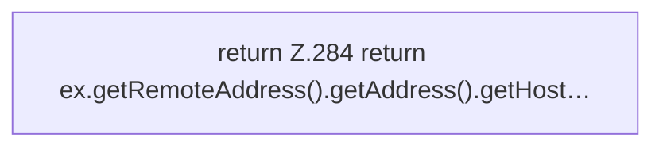

[[00 Start]] › [[Dashboard-HTTP]] › [[HTTP-Auth]] › [[Dashboard.ip]]

# Dashboard.ip

`Dashboard.ip(HttpExchange ex)` [src/main/java/de/aichele/childlauncher/Dashboard.java:284–284](https://github.com/Sciddie/minecraft-serverhoster-plugin/blob/95b02b953b0b4c23673e900e021a7c3c844aa37d/src/main/java/de/aichele/childlauncher/Dashboard.java#L284-L284)



```knoten
return Z.284 return ex.getRemoteAddress().getAddress().getHost…
  Zeile 284: Rückgabe `return ex.getRemoteAddress().getAddress().getHost…`.
```

- `ip` in `src/main/java/de/aichele/childlauncher/Dashboard.java`
