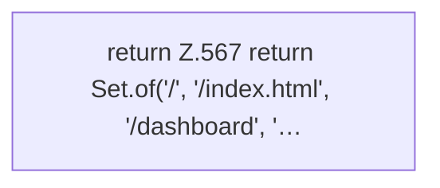

[[00 Start]] › [[Dashboard-HTTP]] › [[HTTP-Routing]] › [[Dashboard.isDashboardPage]]

# Dashboard.isDashboardPage

`Dashboard.isDashboardPage(String path)` [src/main/java/de/aichele/childlauncher/Dashboard.java:566–570](https://github.com/Sciddie/minecraft-serverhoster-plugin/blob/95b02b953b0b4c23673e900e021a7c3c844aa37d/src/main/java/de/aichele/childlauncher/Dashboard.java#L566-L570)

- `isDashboardPage` in `src/main/java/de/aichele/childlauncher/Dashboard.java`
