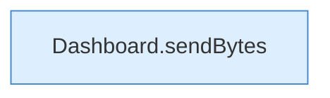

[[00 Start]] › [[Dashboard-HTTP]] › [[API-Antworten]] › [[Dashboard.json]]

# Dashboard.json

`Dashboard.json(HttpExchange ex, int code, Object o)` [src/main/java/de/aichele/childlauncher/Dashboard.java:996–996](https://github.com/Sciddie/minecraft-serverhoster-plugin/blob/95b02b953b0b4c23673e900e021a7c3c844aa37d/src/main/java/de/aichele/childlauncher/Dashboard.java#L996-L996)

- `json` in `src/main/java/de/aichele/childlauncher/Dashboard.java`
