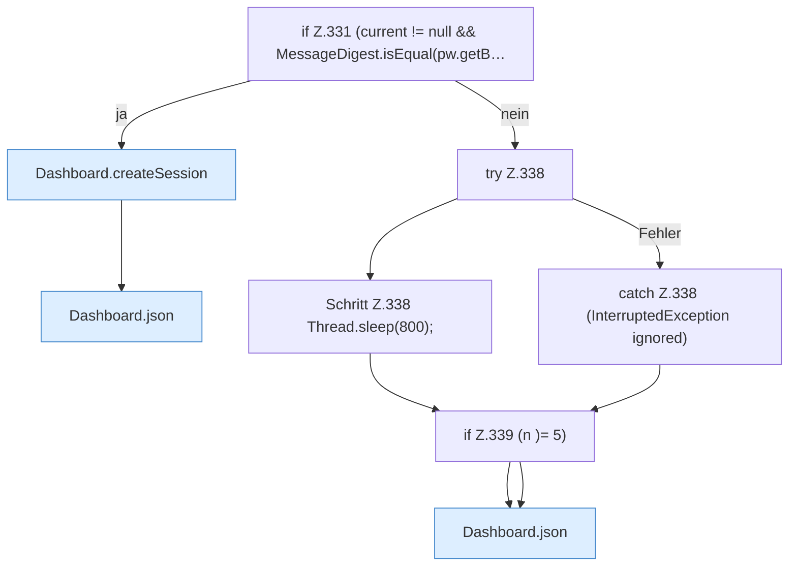

[[00 Start]] › [[Dashboard-HTTP]] › [[HTTP-Auth]] › [[Dashboard.login]] › [[Dashboard.login.Z331]]

# Dashboard.login.Z331



```knoten
if Z.331 (current != null && MessageDigest.isEqual(pw.getB…
  Zeile 331: prüft `(current != null && MessageDigest.isEqual(pw.getB…`.
Dashboard.createSession
  Die [[Glossar#Web-Schnittstelle|Web-Schnittstelle]] legt an die [[Glossar#Anmeldung|Anmeldung]]. Legt an `createSession`. Ruft `cookie`.
Dashboard.json
  Die [[Glossar#Web-Schnittstelle|Web-Schnittstelle]] macht hier einen einzelnen Schritt. Eine Ebene tiefer steht er genauer. Antwortet mit JSON `json`. Ruft `sendBytes`.
try Z.338
  Zeile 338: Versuch. Der Fehlerpfad geht in catch.
Schritt Z.338 Thread.sleep(800);
  Zeile 338: wartet. `Thread.sleep(800);`
catch Z.338 (InterruptedException ignored)
  Zeile 338: fängt (InterruptedException ignored).
if Z.339 (n )= 5)
  Zeile 339: prüft `(n )= 5)`.
```

> [!knoten]- Was die Blöcke tun
> - **if Z.331 (current != null && MessageDigest.isEqual(pw.getB…**: Zeile 331: prüft `(current != null && MessageDigest.isEqual(pw.getB…`.
> - **Dashboard.createSession**: Die [[Glossar#Web-Schnittstelle|Web-Schnittstelle]] legt an die [[Glossar#Anmeldung|Anmeldung]]. Legt an `createSession`. Ruft `cookie`.
> - **Dashboard.json**: Die [[Glossar#Web-Schnittstelle|Web-Schnittstelle]] macht hier einen einzelnen Schritt. Eine Ebene tiefer steht er genauer. Antwortet mit JSON `json`. Ruft `sendBytes`.
> - **try Z.338**: Zeile 338: Versuch. Der Fehlerpfad geht in catch.
> - **Schritt Z.338 Thread.sleep(800);**: Zeile 338: wartet. `Thread.sleep(800);`
> - **catch Z.338 (InterruptedException ignored)**: Zeile 338: fängt (InterruptedException ignored).
> - **if Z.339 (n )= 5)**: Zeile 339: prüft `(n )= 5)`.

- Der Ablauf geht in [[Glossar#Zeile|Zeile]] 331 weiter. Eine Ebene tiefer steht er genauer.
- Fortsetzung von `Dashboard.login`.
