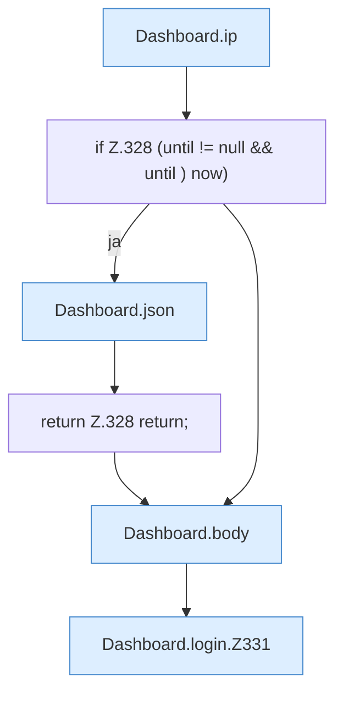

[[00 Start]] › [[Dashboard-HTTP]] › [[HTTP-Auth]] › [[Dashboard.login]]

# Dashboard.login

`Dashboard.login(HttpExchange ex)` [src/main/java/de/aichele/childlauncher/Dashboard.java:324–346](https://github.com/Sciddie/minecraft-serverhoster-plugin/blob/95b02b953b0b4c23673e900e021a7c3c844aa37d/src/main/java/de/aichele/childlauncher/Dashboard.java#L324-L346)



```knoten
Dashboard.ip
  `ip` in `Dashboard.java`.
if Z.328 (until != null && until ) now)
  Zeile 328: prüft `(until != null && until ) now)`.
Dashboard.json
  Antwortet mit JSON `json`. Ruft `sendBytes`.
return Z.328 return;
  Zeile 328: Rückgabe `return;`.
Dashboard.body
  `body` in `Dashboard.java`. Ruft `readBodyText`.
Dashboard.login.Z331
  Fortsetzung des Ablaufs ab Zeile 331.
```

- `login` in `src/main/java/de/aichele/childlauncher/Dashboard.java`
