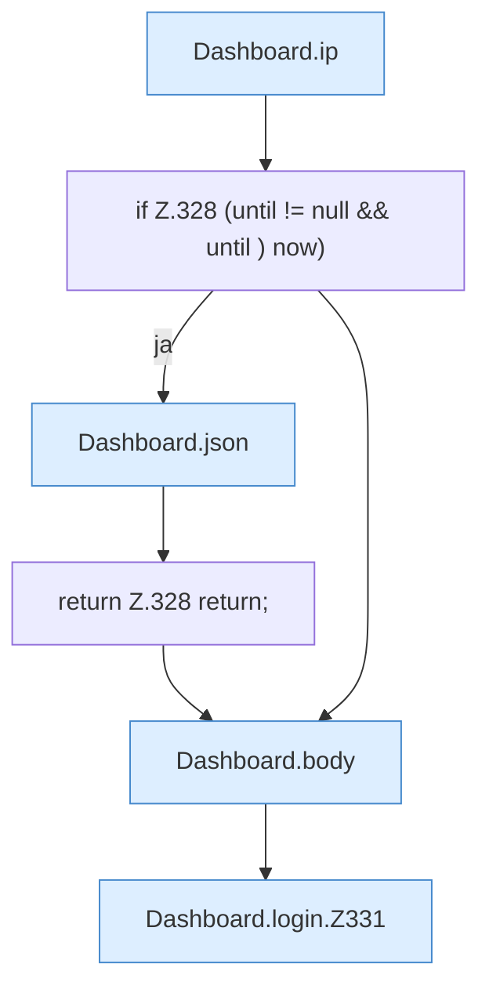

[[00 Start]] › [[Dashboard-HTTP]] › [[HTTP-Auth]] › [[Dashboard.login]]

# Dashboard.login

`Dashboard.login(HttpExchange ex)` [src/main/java/de/aichele/childlauncher/Dashboard.java:324–346](https://github.com/Sciddie/minecraft-serverhoster-plugin/blob/95b02b953b0b4c23673e900e021a7c3c844aa37d/src/main/java/de/aichele/childlauncher/Dashboard.java#L324-L346)



```knoten
Dashboard.ip
  Die [[Glossar#Web-Schnittstelle|Web-Schnittstelle]] macht hier einen einzelnen Schritt. Eine Ebene tiefer steht er genauer. Im [[Glossar#Quelltext|Quelltext]] heißt das `ip`.
if Z.328 (until != null && until ) now)
  Hier fällt eine Entscheidung. Nur wenn sie zutrifft, geht es den Ja-Weg weiter. Das steht in [[Glossar#Zeile|Zeile]] 328.
Dashboard.json
  Die [[Glossar#Web-Schnittstelle|Web-Schnittstelle]] macht hier einen einzelnen Schritt. Eine Ebene tiefer steht er genauer. Im [[Glossar#Quelltext|Quelltext]] heißt das `json`.
return Z.328 return;
  Hier endet die [[Glossar#Funktion|Funktion]] und liefert ein Ergebnis zurück. Das steht in [[Glossar#Zeile|Zeile]] 328.
Dashboard.body
  Die [[Glossar#Web-Schnittstelle|Web-Schnittstelle]] macht hier einen einzelnen Schritt. Eine Ebene tiefer steht er genauer. Im [[Glossar#Quelltext|Quelltext]] heißt das `body`.
Dashboard.login.Z331
  Der Ablauf geht in [[Glossar#Zeile|Zeile]] 331 weiter. Eine Ebene tiefer steht er genauer. Im [[Glossar#Quelltext|Quelltext]] heißt das `Z331`.
```

> [!knoten]- Was die Blöcke tun
> - **Dashboard.ip**: Die [[Glossar#Web-Schnittstelle|Web-Schnittstelle]] macht hier einen einzelnen Schritt. Eine Ebene tiefer steht er genauer. Im [[Glossar#Quelltext|Quelltext]] heißt das `ip`.
> - **if Z.328 (until != null && until ) now)**: Hier fällt eine Entscheidung. Nur wenn sie zutrifft, geht es den Ja-Weg weiter. Das steht in [[Glossar#Zeile|Zeile]] 328.
> - **Dashboard.json**: Die [[Glossar#Web-Schnittstelle|Web-Schnittstelle]] macht hier einen einzelnen Schritt. Eine Ebene tiefer steht er genauer. Im [[Glossar#Quelltext|Quelltext]] heißt das `json`.
> - **return Z.328 return;**: Hier endet die [[Glossar#Funktion|Funktion]] und liefert ein Ergebnis zurück. Das steht in [[Glossar#Zeile|Zeile]] 328.
> - **Dashboard.body**: Die [[Glossar#Web-Schnittstelle|Web-Schnittstelle]] macht hier einen einzelnen Schritt. Eine Ebene tiefer steht er genauer. Im [[Glossar#Quelltext|Quelltext]] heißt das `body`.
> - **Dashboard.login.Z331**: Der Ablauf geht in [[Glossar#Zeile|Zeile]] 331 weiter. Eine Ebene tiefer steht er genauer. Im [[Glossar#Quelltext|Quelltext]] heißt das `Z331`.

- Prüft das Passwort und merkt die [[Glossar#Anmeldung|Anmeldung]].
