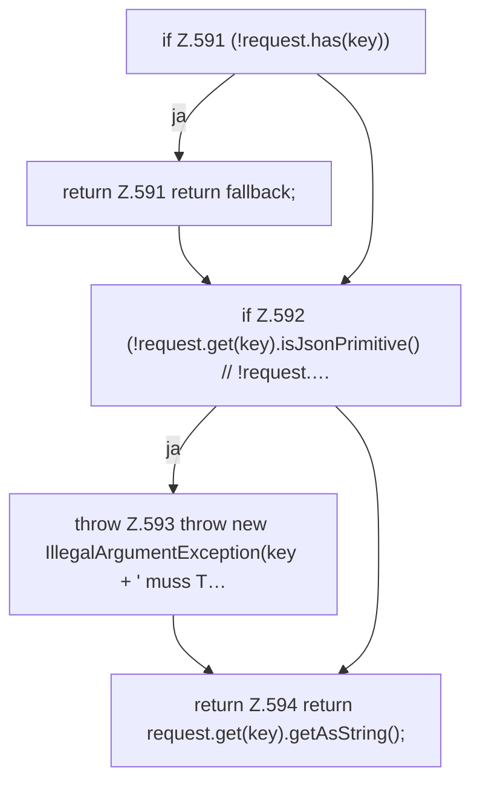

[[00 Start]] › [[Dashboard-HTTP]] › [[API-Setup]] › [[Dashboard.optionalString]]

# Dashboard.optionalString

`Dashboard.optionalString(JsonObject request, String key, String fallback)` [src/main/java/de/aichele/childlauncher/Dashboard.java:590–595](https://github.com/Sciddie/minecraft-serverhoster-plugin/blob/95b02b953b0b4c23673e900e021a7c3c844aa37d/src/main/java/de/aichele/childlauncher/Dashboard.java#L590-L595)



```knoten
if Z.591 (!request.has(key))
  Zeile 591: prüft `(!request.has(key))`.
return Z.591 return fallback;
  Zeile 591: Rückgabe `return fallback;`.
if Z.592 (!request.get(key).isJsonPrimitive() // !request.…
  Zeile 592: prüft `(!request.get(key).isJsonPrimitive() // !request.…`.
throw Z.593 throw new IllegalArgumentException(key + ' muss T…
  Zeile 593: Abbruch `throw new IllegalArgumentException(key + ' muss T…`.
return Z.594 return request.get(key).getAsString();
  Zeile 594: Rückgabe `return request.get(key).getAsString();`.
```

- `optionalString` in `src/main/java/de/aichele/childlauncher/Dashboard.java`
