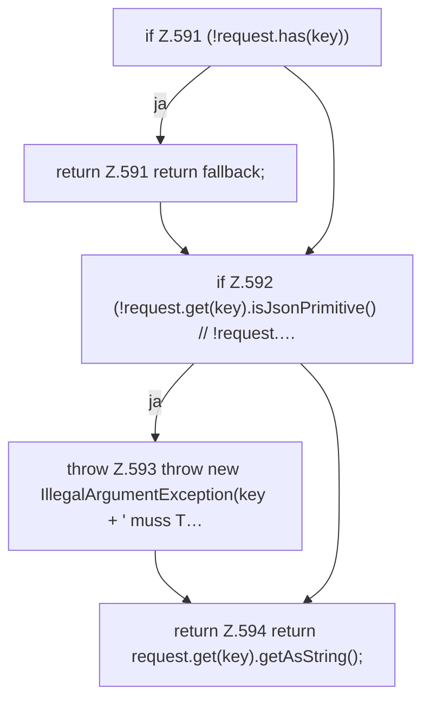

[[00 Start]] › [[Dashboard-HTTP]] › [[API-Setup]] › [[Dashboard.optionalString]]

# Dashboard.optionalString

`Dashboard.optionalString(JsonObject request, String key, String fallback)` [src/main/java/de/aichele/childlauncher/Dashboard.java:590–595](https://github.com/Sciddie/minecraft-serverhoster-plugin/blob/95b02b953b0b4c23673e900e021a7c3c844aa37d/src/main/java/de/aichele/childlauncher/Dashboard.java#L590-L595)

- `optionalString` in `src/main/java/de/aichele/childlauncher/Dashboard.java`
