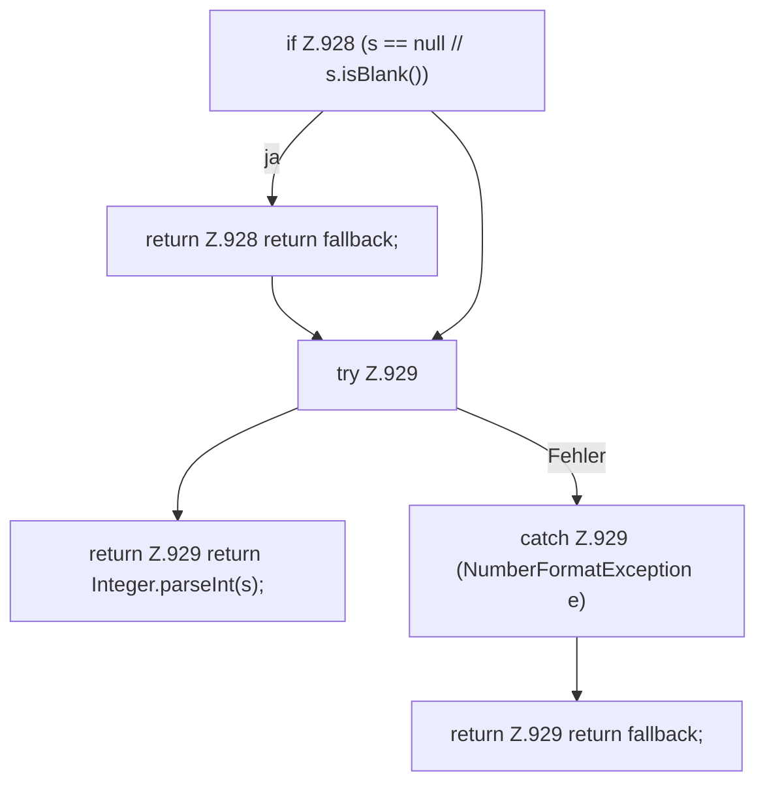

[[00 Start]] › [[Dashboard-HTTP]] › [[API-Antworten]] › [[Dashboard.parseInt]]

# Dashboard.parseInt

`Dashboard.parseInt(String s, int fallback)` [src/main/java/de/aichele/childlauncher/Dashboard.java:927–930](https://github.com/Sciddie/minecraft-serverhoster-plugin/blob/95b02b953b0b4c23673e900e021a7c3c844aa37d/src/main/java/de/aichele/childlauncher/Dashboard.java#L927-L930)



```knoten
if Z.928 (s == null // s.isBlank())
  Hier fällt eine Entscheidung. Nur wenn sie zutrifft, geht es den Ja-Weg weiter. Das steht in [[Glossar#Zeile|Zeile]] 928.
return Z.928 return fallback;
  Hier endet die [[Glossar#Funktion|Funktion]] und liefert ein Ergebnis zurück. Das steht in [[Glossar#Zeile|Zeile]] 928.
try Z.929
  Das Programm versucht diesen Schritt. Geht er schief, führt der andere Weg weiter. Das steht in [[Glossar#Zeile|Zeile]] 929.
return Z.929 return Integer.parseInt(s);
  Hier endet die [[Glossar#Funktion|Funktion]] und liefert ein Ergebnis zurück. Das steht in [[Glossar#Zeile|Zeile]] 929.
catch Z.929 (NumberFormatException e)
  Dieser Weg gilt, wenn der Schritt davor schiefgegangen ist. Das steht in [[Glossar#Zeile|Zeile]] 929.
return Z.929 return fallback;
  Hier endet die [[Glossar#Funktion|Funktion]] und liefert ein Ergebnis zurück. Das steht in [[Glossar#Zeile|Zeile]] 929.
```

> [!knoten]- Was die Blöcke tun
> - **if Z.928 (s == null // s.isBlank())**: Hier fällt eine Entscheidung. Nur wenn sie zutrifft, geht es den Ja-Weg weiter. Das steht in [[Glossar#Zeile|Zeile]] 928.
> - **return Z.928 return fallback;**: Hier endet die [[Glossar#Funktion|Funktion]] und liefert ein Ergebnis zurück. Das steht in [[Glossar#Zeile|Zeile]] 928.
> - **try Z.929**: Das Programm versucht diesen Schritt. Geht er schief, führt der andere Weg weiter. Das steht in [[Glossar#Zeile|Zeile]] 929.
> - **return Z.929 return Integer.parseInt(s);**: Hier endet die [[Glossar#Funktion|Funktion]] und liefert ein Ergebnis zurück. Das steht in [[Glossar#Zeile|Zeile]] 929.
> - **catch Z.929 (NumberFormatException e)**: Dieser Weg gilt, wenn der Schritt davor schiefgegangen ist. Das steht in [[Glossar#Zeile|Zeile]] 929.
> - **return Z.929 return fallback;**: Hier endet die [[Glossar#Funktion|Funktion]] und liefert ein Ergebnis zurück. Das steht in [[Glossar#Zeile|Zeile]] 929.

- Die [[Glossar#Web-Schnittstelle|Web-Schnittstelle]] liest eine Zahl.
