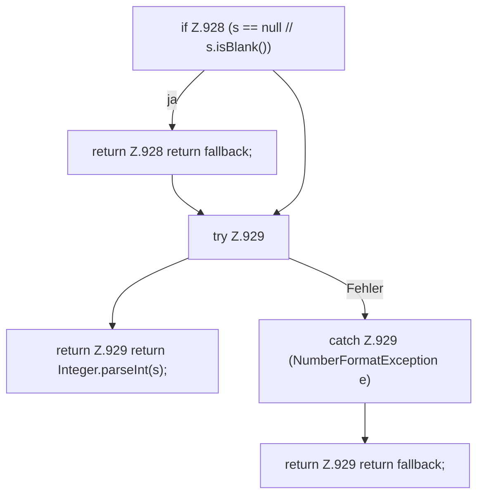

[[00 Start]] › [[Dashboard-HTTP]] › [[API-Antworten]] › [[Dashboard.parseInt]]

# Dashboard.parseInt

`Dashboard.parseInt(String s, int fallback)` [src/main/java/de/aichele/childlauncher/Dashboard.java:927–930](https://github.com/Sciddie/minecraft-serverhoster-plugin/blob/95b02b953b0b4c23673e900e021a7c3c844aa37d/src/main/java/de/aichele/childlauncher/Dashboard.java#L927-L930)



```knoten
if Z.928 (s == null // s.isBlank())
  Zeile 928: prüft `(s == null // s.isBlank())`.
return Z.928 return fallback;
  Zeile 928: Rückgabe `return fallback;`.
try Z.929
  Zeile 929: Versuch. Der Fehlerpfad geht in catch.
return Z.929 return Integer.parseInt(s);
  Zeile 929: Rückgabe `return Integer.parseInt(s);`.
catch Z.929 (NumberFormatException e)
  Zeile 929: fängt (NumberFormatException e).
return Z.929 return fallback;
  Zeile 929: Rückgabe `return fallback;`.
```

- `parseInt` in `src/main/java/de/aichele/childlauncher/Dashboard.java`
