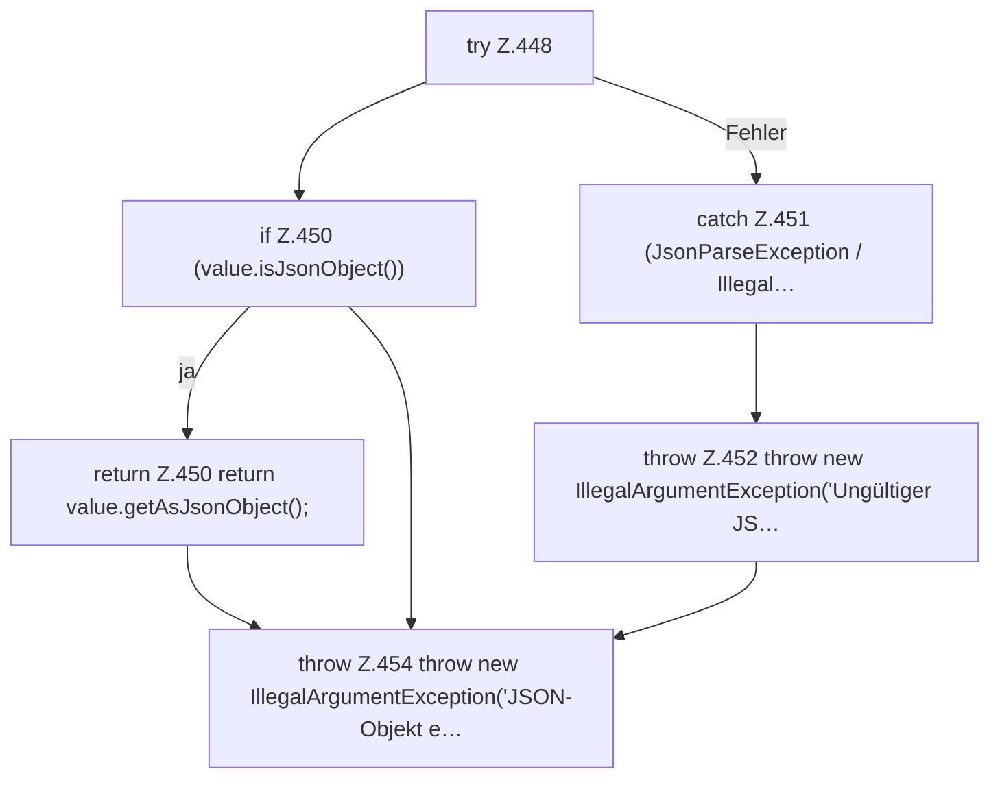

[[00 Start]] › [[Dashboard-HTTP]] › [[API-Zeit]] › [[Dashboard.parseJsonObject]]

# Dashboard.parseJsonObject

`Dashboard.parseJsonObject(String json)` [src/main/java/de/aichele/childlauncher/Dashboard.java:447–455](https://github.com/Sciddie/minecraft-serverhoster-plugin/blob/95b02b953b0b4c23673e900e021a7c3c844aa37d/src/main/java/de/aichele/childlauncher/Dashboard.java#L447-L455)



```knoten
try Z.448
  Zeile 448: Versuch. Der Fehlerpfad geht in catch.
if Z.450 (value.isJsonObject())
  Zeile 450: prüft `(value.isJsonObject())`.
return Z.450 return value.getAsJsonObject();
  Zeile 450: Rückgabe `return value.getAsJsonObject();`.
catch Z.451 (JsonParseException / Illegal…
  Zeile 451: fängt (JsonParseException / Illegal….
throw Z.452 throw new IllegalArgumentException('Ungültiger JS…
  Zeile 452: Abbruch `throw new IllegalArgumentException('Ungültiger JS…`.
throw Z.454 throw new IllegalArgumentException('JSON-Objekt e…
  Zeile 454: Abbruch `throw new IllegalArgumentException('JSON-Objekt e…`.
```

- `parseJsonObject` in `src/main/java/de/aichele/childlauncher/Dashboard.java`
