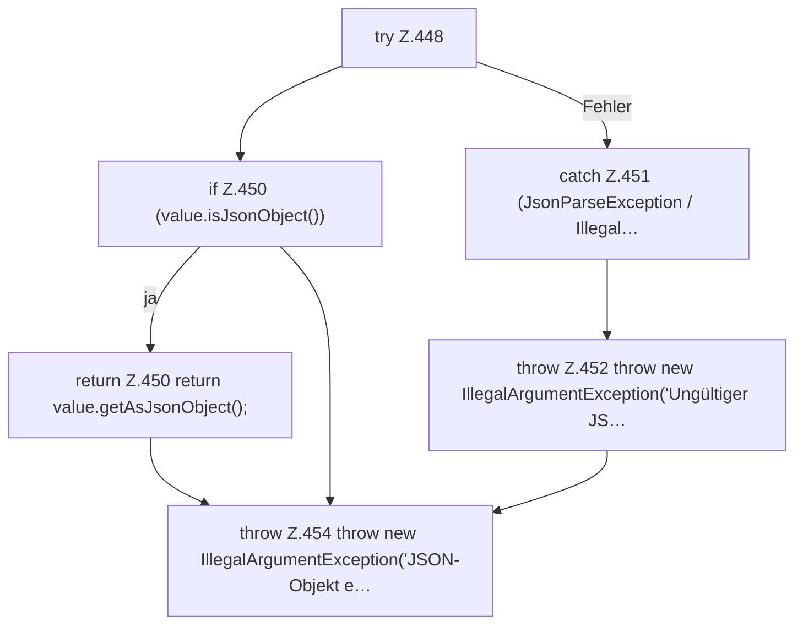

[[00 Start]] › [[Dashboard-HTTP]] › [[API-Zeit]] › [[Dashboard.parseJsonObject]]

# Dashboard.parseJsonObject

`Dashboard.parseJsonObject(String json)` [src/main/java/de/aichele/childlauncher/Dashboard.java:447–455](https://github.com/Sciddie/minecraft-serverhoster-plugin/blob/95b02b953b0b4c23673e900e021a7c3c844aa37d/src/main/java/de/aichele/childlauncher/Dashboard.java#L447-L455)



```knoten
try Z.448
  Das Programm versucht diesen Schritt. Geht er schief, führt der andere Weg weiter. Das steht in [[Glossar#Zeile|Zeile]] 448.
if Z.450 (value.isJsonObject())
  Hier fällt eine Entscheidung. Nur wenn sie zutrifft, geht es den Ja-Weg weiter. Das steht in [[Glossar#Zeile|Zeile]] 450.
return Z.450 return value.getAsJsonObject();
  Hier endet die [[Glossar#Funktion|Funktion]] und liefert ein Ergebnis zurück. Das steht in [[Glossar#Zeile|Zeile]] 450.
catch Z.451 (JsonParseException / Illegal…
  Dieser Weg gilt, wenn der Schritt davor schiefgegangen ist. Das steht in [[Glossar#Zeile|Zeile]] 451.
throw Z.452 throw new IllegalArgumentException('Ungültiger JS…
  Hier bricht die [[Glossar#Funktion|Funktion]] ab, weil etwas nicht geklappt hat. Das steht in [[Glossar#Zeile|Zeile]] 452.
throw Z.454 throw new IllegalArgumentException('JSON-Objekt e…
  Hier bricht die [[Glossar#Funktion|Funktion]] ab, weil etwas nicht geklappt hat. Das steht in [[Glossar#Zeile|Zeile]] 454.
```

> [!knoten]- Was die Blöcke tun
> - **try Z.448**: Das Programm versucht diesen Schritt. Geht er schief, führt der andere Weg weiter. Das steht in [[Glossar#Zeile|Zeile]] 448.
> - **if Z.450 (value.isJsonObject())**: Hier fällt eine Entscheidung. Nur wenn sie zutrifft, geht es den Ja-Weg weiter. Das steht in [[Glossar#Zeile|Zeile]] 450.
> - **return Z.450 return value.getAsJsonObject();**: Hier endet die [[Glossar#Funktion|Funktion]] und liefert ein Ergebnis zurück. Das steht in [[Glossar#Zeile|Zeile]] 450.
> - **catch Z.451 (JsonParseException / Illegal…**: Dieser Weg gilt, wenn der Schritt davor schiefgegangen ist. Das steht in [[Glossar#Zeile|Zeile]] 451.
> - **throw Z.452 throw new IllegalArgumentException('Ungültiger JS…**: Hier bricht die [[Glossar#Funktion|Funktion]] ab, weil etwas nicht geklappt hat. Das steht in [[Glossar#Zeile|Zeile]] 452.
> - **throw Z.454 throw new IllegalArgumentException('JSON-Objekt e…**: Hier bricht die [[Glossar#Funktion|Funktion]] ab, weil etwas nicht geklappt hat. Das steht in [[Glossar#Zeile|Zeile]] 454.

- Die [[Glossar#Web-Schnittstelle|Web-Schnittstelle]] liest die Antwort den Inhalt.
