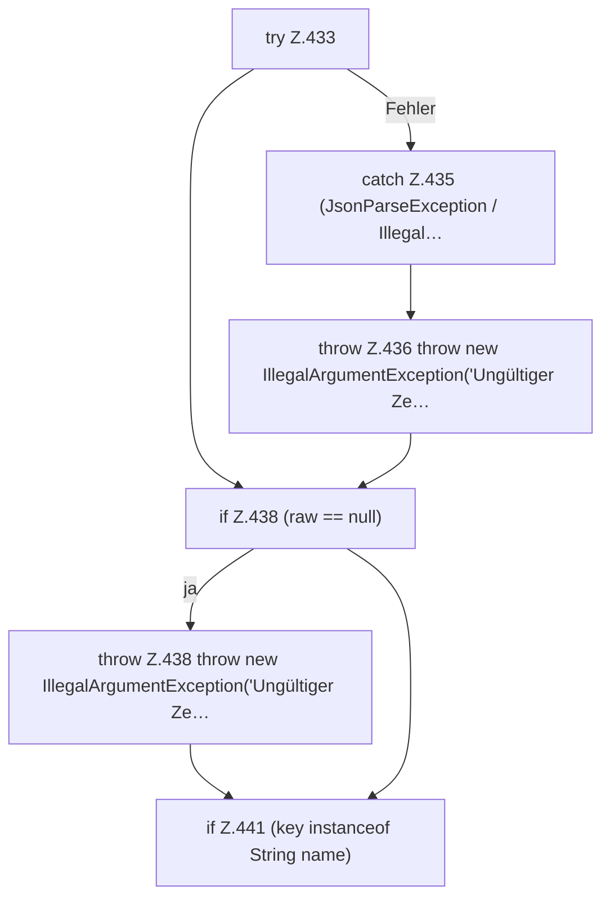

[[00 Start]] › [[Dashboard-HTTP]] › [[API-Zeit]] › [[Dashboard.parseSchedule]] › [[Dashboard.parseSchedule.Teil1]]

# Dashboard.parseSchedule.Teil1



```knoten
try Z.433
  Zeile 433: Versuch. Der Fehlerpfad geht in catch.
catch Z.435 (JsonParseException / Illegal…
  Zeile 435: fängt (JsonParseException / Illegal….
throw Z.436 throw new IllegalArgumentException('Ungültiger Ze…
  Zeile 436: Abbruch `throw new IllegalArgumentException('Ungültiger Ze…`.
if Z.438 (raw == null)
  Zeile 438: prüft `(raw == null)`.
throw Z.438 throw new IllegalArgumentException('Ungültiger Ze…
  Zeile 438: Abbruch `throw new IllegalArgumentException('Ungültiger Ze…`.
if Z.441 (key instanceof String name)
  Zeile 441: prüft `(key instanceof String name)`.
```

> [!knoten]- Was die Blöcke tun
> - **try Z.433**: Zeile 433: Versuch. Der Fehlerpfad geht in catch.
> - **catch Z.435 (JsonParseException / Illegal…**: Zeile 435: fängt (JsonParseException / Illegal….
> - **throw Z.436 throw new IllegalArgumentException('Ungültiger Ze…**: Zeile 436: Abbruch `throw new IllegalArgumentException('Ungültiger Ze…`.
> - **if Z.438 (raw == null)**: Zeile 438: prüft `(raw == null)`.
> - **throw Z.438 throw new IllegalArgumentException('Ungültiger Ze…**: Zeile 438: Abbruch `throw new IllegalArgumentException('Ungültiger Ze…`.
> - **if Z.441 (key instanceof String name)**: Zeile 441: prüft `(key instanceof String name)`.

- Ein weiterer Abschnitt derselben Übersicht.
- Fortsetzung von `Dashboard.parseSchedule`.
