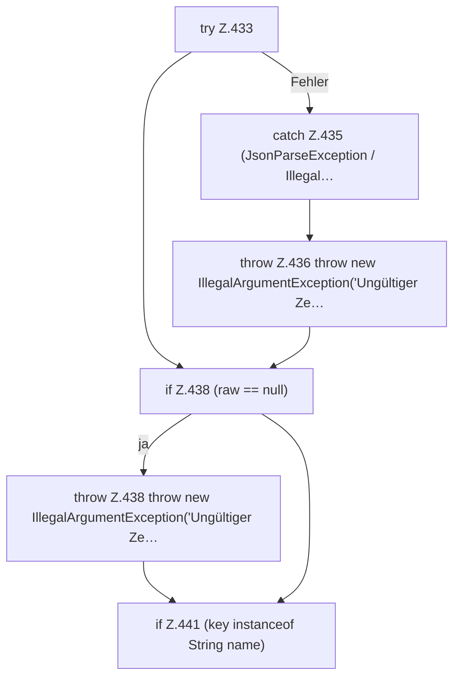

[[00 Start]] › [[Dashboard-HTTP]] › [[API-Zeit]] › [[Dashboard.parseSchedule]] › [[Dashboard.parseSchedule.Teil1]]

# Dashboard.parseSchedule.Teil1

- Fortsetzung von `Dashboard.parseSchedule`, Quellreihenfolge.
