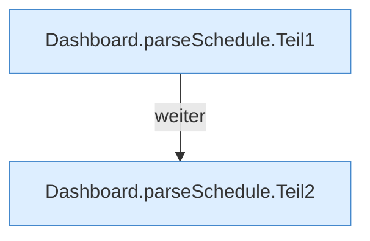

[[00 Start]] › [[Dashboard-HTTP]] › [[API-Zeit]] › [[Dashboard.parseSchedule]]

# Dashboard.parseSchedule

`Dashboard.parseSchedule(String json)` [src/main/java/de/aichele/childlauncher/Dashboard.java:431–445](https://github.com/Sciddie/minecraft-serverhoster-plugin/blob/95b02b953b0b4c23673e900e021a7c3c844aa37d/src/main/java/de/aichele/childlauncher/Dashboard.java#L431-L445)

- `parseSchedule` in `src/main/java/de/aichele/childlauncher/Dashboard.java`
