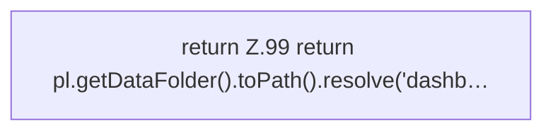

[[00 Start]] › [[Dashboard-HTTP]] › [[HTTP-Start]] › [[Dashboard.passwordFile]]

# Dashboard.passwordFile

`Dashboard.passwordFile()` [src/main/java/de/aichele/childlauncher/Dashboard.java:99–99](https://github.com/Sciddie/minecraft-serverhoster-plugin/blob/95b02b953b0b4c23673e900e021a7c3c844aa37d/src/main/java/de/aichele/childlauncher/Dashboard.java#L99-L99)



```knoten
return Z.99 return pl.getDataFolder().toPath().resolve('dashb…
  Zeile 99: Rückgabe `return pl.getDataFolder().toPath().resolve('dashb…`.
```

- `passwordFile` in `src/main/java/de/aichele/childlauncher/Dashboard.java`
