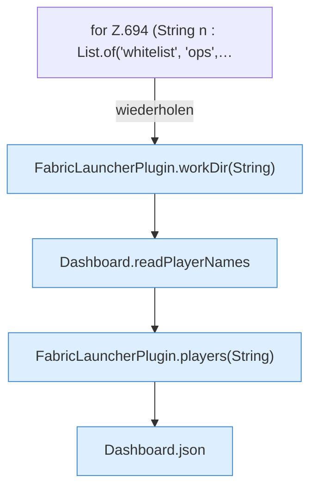

[[00 Start]] › [[Dashboard-HTTP]] › [[API-Spieler]] › [[Dashboard.players]]

# Dashboard.players

`Dashboard.players(HttpExchange ex, String sid)` [src/main/java/de/aichele/childlauncher/Dashboard.java:692–700](https://github.com/Sciddie/minecraft-serverhoster-plugin/blob/95b02b953b0b4c23673e900e021a7c3c844aa37d/src/main/java/de/aichele/childlauncher/Dashboard.java#L692-L700)



```knoten
for Z.694 (String n : List.of('whitelist', 'ops',…
  Zeile 694: Schleife `(String n : List.of('whitelist', 'ops',…`.
FabricLauncherPlugin.workDir(String)
  `workDir` in `FabricLauncherPlugin.java`. Ruft `profile`, `directory`.
Dashboard.readPlayerNames
  Liest `readPlayerNames`.
FabricLauncherPlugin.players(String)
  Liefert die Spieler `players`. Ruft `slot`.
Dashboard.json
  Antwortet mit JSON `json`. Ruft `sendBytes`.
```

- `players` in `src/main/java/de/aichele/childlauncher/Dashboard.java`
