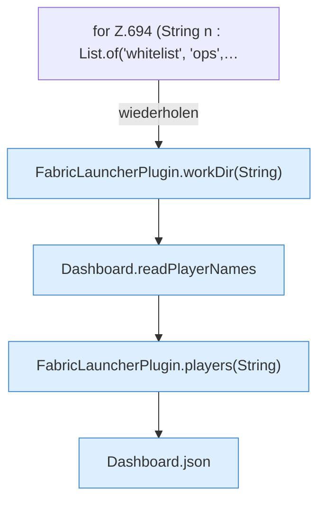

[[00 Start]] › [[Dashboard-HTTP]] › [[API-Spieler]] › [[Dashboard.players]]

# Dashboard.players

`Dashboard.players(HttpExchange ex, String sid)` [src/main/java/de/aichele/childlauncher/Dashboard.java:692–700](https://github.com/Sciddie/minecraft-serverhoster-plugin/blob/95b02b953b0b4c23673e900e021a7c3c844aa37d/src/main/java/de/aichele/childlauncher/Dashboard.java#L692-L700)

- `players` in `src/main/java/de/aichele/childlauncher/Dashboard.java`
