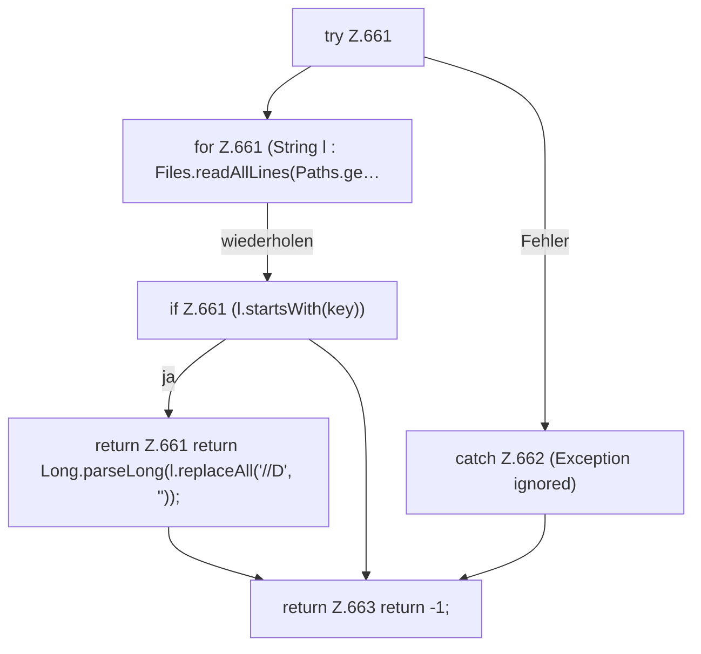

[[00 Start]] › [[Dashboard-HTTP]] › [[API-Status]] › [[Dashboard.procField]]

# Dashboard.procField

`Dashboard.procField(long pid, String key)` [src/main/java/de/aichele/childlauncher/Dashboard.java:660–664](https://github.com/Sciddie/minecraft-serverhoster-plugin/blob/95b02b953b0b4c23673e900e021a7c3c844aa37d/src/main/java/de/aichele/childlauncher/Dashboard.java#L660-L664)



```knoten
try Z.661
  Zeile 661: Versuch. Der Fehlerpfad geht in catch.
for Z.661 (String l : Files.readAllLines(Paths.ge…
  Zeile 661: Schleife `(String l : Files.readAllLines(Paths.ge…`.
if Z.661 (l.startsWith(key))
  Zeile 661: prüft `(l.startsWith(key))`.
return Z.661 return Long.parseLong(l.replaceAll('//D', ''));
  Zeile 661: Rückgabe `return Long.parseLong(l.replaceAll('//D', ''));`.
catch Z.662 (Exception ignored)
  Zeile 662: fängt (Exception ignored).
return Z.663 return -1;
  Zeile 663: Rückgabe `return -1;`.
```

- `procField` in `src/main/java/de/aichele/childlauncher/Dashboard.java`
