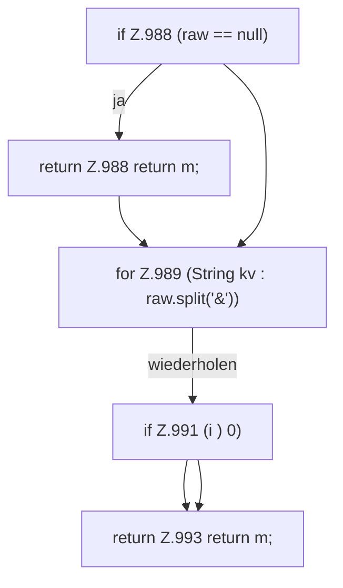

[[00 Start]] › [[Dashboard-HTTP]] › [[API-Antworten]] › [[Dashboard.query]]

# Dashboard.query

`Dashboard.query(HttpExchange ex)` [src/main/java/de/aichele/childlauncher/Dashboard.java:985–994](https://github.com/Sciddie/minecraft-serverhoster-plugin/blob/95b02b953b0b4c23673e900e021a7c3c844aa37d/src/main/java/de/aichele/childlauncher/Dashboard.java#L985-L994)

- `query` in `src/main/java/de/aichele/childlauncher/Dashboard.java`
